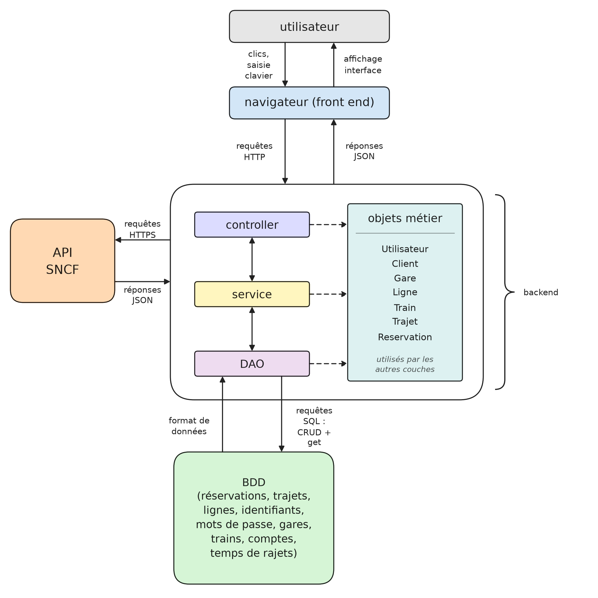
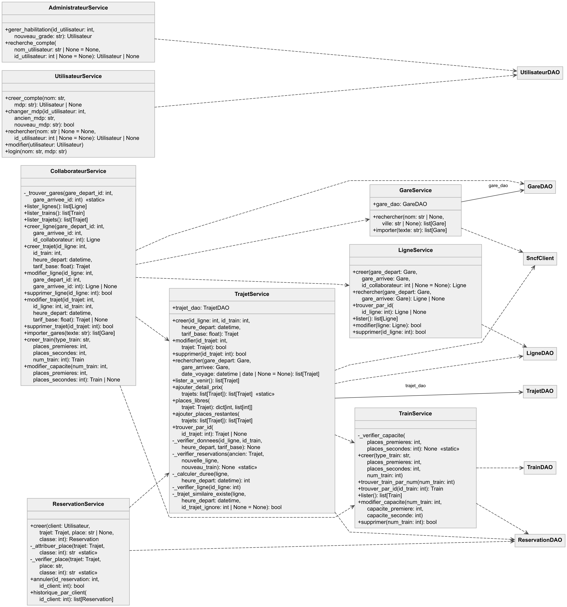

---
format:
  pdf:
    documentclass: scrartcl
    papersize: a4
    toc: false
    fontsize: "11pt"
    linestretch: 1.0
    colorlinks: true
    linkcolor: black
    urlcolor: black
    fig-cap-location: bottom
    include-in-header:
      text: |
        \usepackage{graphicx}
        \usepackage{float}
        % En-tete : nom de l'application a gauche, nom du chapitre a droite
        \usepackage[automark,headsepline]{scrlayer-scrpage}
        \clearpairofpagestyles
        \ihead{Concurrent SNCF}
        \ohead{\leftmark}
        \cfoot*{\pagemark}
        \setkomafont{pageheadfoot}{\normalfont\small}
        \setkomafont{pagenumber}{\normalfont}
        % Titres et legendes
        % Police : Latin Modern Roman (police classique de LaTeX) pour le texte et les titres
        \addtokomafont{disposition}{\rmfamily}
        \addtokomafont{caption}{\small}
        \addtokomafont{captionlabel}{\bfseries}
        % Listes a puces et tableaux aeres
        \AtBeginDocument{\renewcommand{\labelitemi}{\textbullet}\ifdefined\Frlabelitemi\renewcommand{\Frlabelitemi}{\textbullet}\fi}
        \KOMAoptions{captions=tablesignature}
        \usepackage{needspace}
        \usepackage{etoolbox}
        % Noms de fichiers, de classes et de fonctions : en italique, dans la police du texte
        \newcommand{\finsouligne}{{\mdseries\scalebox{0.7}[1]{\textunderscore}}}
        \AtBeginDocument{\let\_\finsouligne}
        \DeclareRobustCommand{\texttt}[1]{\mbox{\normalfont\itshape #1}}
        % Tableaux : bordure complete
        \usepackage{array}
        \AtBeginEnvironment{tabular}{\let\_\finsouligne}
        % Table des figures : "Figure 1", liste des tables : "Table 1"
        \newcommand{\numfigure}[1]{Figure~#1 : }
        \newcommand{\numtable}[1]{Table~#1 : }
        \DeclareTOCStyleEntry[indent=0pt,numwidth=4.3em,entrynumberformat=\numfigure]{tocline}{figure}
        \DeclareTOCStyleEntry[indent=0pt,numwidth=4.3em,entrynumberformat=\numtable]{tocline}{table}
        \setlength{\emergencystretch}{8em}
        % Listes : pas de coupure de page juste avant, espacement regulier
        \makeatletter
        \AtBeginDocument{\@beginparpenalty=10000}
        \BeforeBeginEnvironment{enumerate}{\par\nopagebreak\vspace{-0.45\baselineskip}}
        \AfterEndEnvironment{enumerate}{\par\vspace{-0.45\baselineskip}}
        \makeatother
        % Paragraphe en retrait, a la suite d'une sous-partie
        \newcommand{\Suite}{\par\noindent\hangindent=1.5em\hangafter=0 \ignorespaces}
        % Legendes : "Figure 1 : titre"
        \AtBeginDocument{\renewcommand*{\captionformat}{ : }\ifdefined\captionsetup\DeclareCaptionLabelSeparator{deuxpoints}{ : }\captionsetup{labelsep=deuxpoints}\fi}
        % Placement des figures : le texte remplit la page si la figure n'y tient pas
        \renewcommand{\topfraction}{0.9}
        \renewcommand{\bottomfraction}{0.8}
        \renewcommand{\textfraction}{0.08}
        \renewcommand{\floatpagefraction}{0.95}
        % Titres : taille croissante selon le niveau
        \definecolor{bleumarine}{HTML}{1B2A5C}
        \definecolor{bleufilet}{HTML}{4472C4}
        \definecolor{gristexte}{HTML}{5F5F5F}
        \setkomafont{section}{\fontsize{20}{24}\selectfont}
        \setkomafont{subsection}{\fontsize{16}{20}\selectfont}
        \setkomafont{subsubsection}{\fontsize{13.5}{17}\selectfont}
        \setkomafont{paragraph}{\fontsize{12}{15}\selectfont}
        \AtBeginDocument{%
        \RedeclareSectionCommand[runin=false,beforeskip=2.2ex plus .5ex,afterskip=1.4ex]{section}%
        \RedeclareSectionCommand[runin=false,beforeskip=3ex plus .6ex minus .2ex,afterskip=1.2ex]{subsection}%
        \RedeclareSectionCommand[runin=false,beforeskip=2.6ex plus .5ex minus .2ex,afterskip=.9ex]{subsubsection}%
        \RedeclareSectionCommand[runin=false,beforeskip=2.2ex plus .4ex minus .2ex,afterskip=.6ex]{paragraph}}
        \widowpenalty=10000 \clubpenalty=10000
        % Deux points apres les sous-sous-titres (absents de la table des matieres)
        \makeatletter
        \newcommand{\deuxpoints}[1]{\ifstr{#1}{subsubsection}{ :}{\ifstr{#1}{paragraph}{ :}{}}}
        \renewcommand{\sectionlinesformat}[4]{\@hangfrom{\hskip #2#3}{#4\deuxpoints{#1}}}
        \makeatother
        % Sous-partie : titre suivi de deux points, puis texte en retrait a la ligne
        \newcommand{\Rubrique}[1]{\par\addvspace{0.35\baselineskip}\Needspace{5\baselineskip}\noindent\hangindent=1.5em\hangafter=1{\bfseries #1 :}\vadjust{\kern0.2em}\newline\ignorespaces\ignorespaces}
        % Fonctionnalite : meme style en bleu marine, sans coupure entre deux pages
        \newcommand{\Fonction}[2]{\Rubrique{\color{bleumarine}#1 -- #2}\interlinepenalty=10000\AddToHookNext{para/after}{\interlinepenalty=0}}
        \AtBeginDocument{\renewcommand{\tightlist}{\setlength{\itemsep}{2pt}\setlength{\parskip}{0pt}}}
    geometry:
      - top=28mm
      - left=25mm
      - right=25mm
      - bottom=25mm
execute:
  echo: false
  warning: false
editor:
  markdown:
    wrap: 72
lang: fr
---

\begin{titlepage}
\thispagestyle{empty}
\sffamily\fontsize{12.5}{15.0}\selectfont
\parfillskip=0pt
\vspace*{-1.4cm}

% Logos
\noindent
\begin{minipage}[c]{0.60\textwidth}
\raisebox{-0.5\height}{\includegraphics[width=3.9cm]{images/ensai-logo.png}}\hspace{0.1cm}%
\raisebox{-0.35\height}{\parbox{5cm}{\footnotesize\color{gristexte}École nationale\\ de la statistique\\ et de l'analyse\\ de l'information}}
\end{minipage}\hfill
\begin{minipage}[c]{0.30\textwidth}
\raggedleft\includegraphics[width=3cm]{images/logo_sncf.png}
\end{minipage}

\vspace{1.7cm}

% Titre
\begin{center}
{\fontsize{24}{28.8}\selectfont\bfseries Projet informatique 2A\par}
\vspace{0.3cm}
{\fontsize{15}{18.0}\selectfont Équipe 31\par}
\end{center}

\vspace{0.9cm}
{\noindent\color{bleufilet}\rule{\textwidth}{1.2pt}\par}
\vspace{0.5cm}
\begin{center}
{\fontsize{30}{36.0}\selectfont\bfseries Concurrent SNCF\par}
\vspace{0.45cm}
{\fontsize{15}{18.0}\selectfont\itshape Rapport final\par}
\vspace{0.45cm}
{\itshape API de gestion des lignes, des trajets et des réservations\par}
\end{center}
\vspace{0.5cm}
{\noindent\color{bleufilet}\rule{\textwidth}{1.2pt}\par}

\vspace{1.3cm}

% Étudiants et encadrant
\noindent
\begin{minipage}[t]{0.5\textwidth}
\raggedright
\textbf{Étudiants :}\\[0.15cm]
Adam \textsc{\rmfamily Benamer}\\
Satya \textsc{\rmfamily Kremer}\\
Nathan \textsc{\rmfamily Tiatia}\\
Laurine \textsc{\rmfamily Leroy}\\
Lou-Ann \textsc{\rmfamily Clement}\\
Nour \textsc{\rmfamily Nsiri}
\end{minipage}\hfill
\begin{minipage}[t]{0.45\textwidth}
\raggedleft
\textbf{Encadrant pédagogique :}\\[0.15cm]
Kévin \textsc{\rmfamily Leroy}
\end{minipage}

\vfill

% Année universitaire
\begin{center}
Année universitaire 2026--2027
\end{center}

\end{titlepage}

```{=latex}
\pagenumbering{arabic}
\begingroup
\small
\tableofcontents
\clearpage
\renewcommand{\listfigurename}{Table des figures}
\renewcommand{\listtablename}{Liste des tables}
\listoffigures
\listoftables
\endgroup
```
\newpage

# Introduction

Dans un monde exigeant une grande mobilité des personnes et des biens, se déplacer est devenu un enjeu majeur pour tous et toutes. Cependant, ces déplacements viennent souvent à l'encontre de préoccupations environnementales grandissantes. En effet, les trajets en avion ou même en voiture sont extrêmement polluants : il est donc pertinent de se pencher sur l'une de leurs alternatives les plus vertes, c'est-à-dire le train, une industrie inestimable pour faire face aux enjeux climatiques de notre monde. Ainsi, il est tout aussi nécessaire d'avoir des services qui font fonctionner la concurrence, afin de permettre aux utilisateurs des chemins de fer d'avoir la meilleure expérience possible. C'est pour cette raison que la création d'un concurrent à la SNCF s'impose comme un sujet particulièrement important, et demandant un traitement attentif et complet.

Ce travail a été réalisé dans le cadre du projet informatique de deuxième année de l'ENSAI, encadré par Kévin Leroy. Le sujet nous place dans le rôle de développeurs pour une nouvelle société de transport ferroviaire qui exploite le réseau SNCF. Cette société a besoin d'une application qui réponde aux attentes de chacun de ses utilisateurs :

- **les collaborateurs** de son service commercial doivent organiser l'offre de la compagnie, c'est-à-dire créer et faire évoluer ses lignes, ses trains et ses trajets à partir des données de la SNCF ;
- **les clients** souhaitent trouver un trajet et réserver leur place facilement. Ils ont aussi besoin de prix clairs : à la SNCF, ceux-ci varient selon la demande et la date de réservation, sans que le client sache toujours à quoi correspond le montant affiché ;
- **les administrateurs** doivent gérer les comptes et contrôler les droits de chacun.

Une question se pose alors : **comment concevoir une application fiable et sécurisée, qui permette à une compagnie ferroviaire de gérer son offre et à ses clients de réserver un trajet à un prix clair, en s'appuyant sur les données de la SNCF sans en dépendre entièrement ?**

Pour y répondre, notre objectif est de fournir au service commercial une API lui permettant de gérer ses lignes et ses trajets, et aux clients de les rechercher et de les réserver. Afin d'accomplir cela, nous avons développé une application qui met en place l'ensemble des fonctionnalités du sujet, avec comme positionnement commercial la tarification transparente.

Ce rapport vise à expliquer dans le détail comment cette application a été conçue, structurée et codée par notre équipe. Nous verrons dans un premier temps le contexte de l'application et le cahier des charges dressé, ainsi que l'organisation de travail mise en place au sein de l'équipe. Puis nous nous pencherons sur la modélisation de notre application et son architecture générale. Nous nous intéresserons ensuite à l'implémentation, notamment par le biais de diagrammes de séquence, afin d'expliciter les différentes couches de code mises en place et leurs interactions. Nous présenterons également les tests, la documentation et les outils utilisés dans une démarche d'assurance qualité. Enfin, la conclusion reviendra sur le travail réalisé, ses limites et les possibles évolutions de notre application.

\clearpage

# I. Présentation du projet

## 1.  Cahier des charges et fonctionnalités de l'application

Au cours de ce semestre, nous avons donc développé une application proposant les cinq fonctionnalités de base et les deux fonctionnalités optionnelles prévues par le sujet. L’API SNCF nous fournit les gares et les temps de trajet ; les lignes, les trains, les trajets, les prix et les réservations sont propres à notre application. La récupération, l'exploitation et l'enregistrement de ces données SNCF seront présentés avec les couches de code.

### Fonctionnalités de base

`\Fonction{F1}{Gestion des comptes utilisateurs}`{=latex} Cette fonctionnalité permet d’avoir les différents niveaux d’habilitation nécessaires à l’application. Ceux-ci sont au nombre de trois : les administrateurs sont les seuls à pouvoir changer le niveau d’habilitation d’autres comptes, mais ont aussi accès à toutes les fonctionnalités des deux autres catégories de compte, les collaborateurs et les clients. Tandis que les collaborateurs peuvent créer des lignes et trajets ainsi que lister les lignes, trains et trajets créés, les clients ne peuvent que rechercher ces trajets et les réserver.

`\Fonction{F2}{Gestion des lignes d’exploitation}`{=latex} La gestion des lignes est effectuée par les comptes collaborateurs, en utilisant l’API externe de la SNCF. Pour faire cela, les collaborateurs importent d'abord des gares existantes, puis choisissent deux de ces gares pour créer une ligne, qu'ils peuvent modifier ou supprimer.

`\Fonction{F3}{Gestion des trajets proposés}`{=latex} Un trajet se trouve sur une ligne, et possède donc une date et une heure de départ et un tarif. Le temps de trajet est calculé avec l’API SNCF, tandis que le nombre de places est celui du train choisi par le collaborateur. En plus de cela, notre code vérifie que la ligne existe et qu'un trajet en train est possible entre les deux gares. Enfin, les comptes collaborateurs peuvent modifier ou supprimer un trajet.

`\Fonction{F4}{Recherche d’un trajet}`{=latex} Un compte client peut rechercher les trajets créés grâce à la fonctionnalité précédente, en entrant une gare de départ et une gare d’arrivée, et éventuellement un jour. À l’issue de cette recherche, toutes les informations nécessaires lors de la création d’un trajet sont visibles par le client.

`\Fonction{F5}{Positionnement commercial}`{=latex} Cette fonctionnalité était laissée libre. Nous avons choisi d’implémenter la tarification transparente : ainsi, dès la recherche d’un trajet, un client peut voir les différentes composantes du prix total. Nous affichons aussi dans la recherche le nombre de places restantes dans chaque classe (première ou deuxième).

\Needspace{8\baselineskip}

### Fonctionnalités optionnelles

`\Fonction{FO1}{Réservation de trajet}`{=latex} Cette fonctionnalité permet à un compte client de réserver et annuler une réservation, ainsi que de visualiser ses réservations.

`\Fonction{FO2}{Classes de voyage}`{=latex} Chaque train dispose d’une première et d’une seconde classe, avec des tarifs différents. Le client choisit sa classe lors de la réservation.

### Hypothèses de fonctionnement

Le sujet laissant certains points libres, nous avons retenu les hypothèses suivantes :

- **un trajet est direct** : il se fait sur une seule ligne, avec un seul train, sans arrêt intermédiaire ni correspondance ;
- **le nombre de places d'un trajet est celui de son train**, et les places sont numérotées de 1 à la capacité de chaque classe ;
- **un train a deux classes** : la seconde classe coûte le tarif de base du trajet, et la première classe 1,5 fois ce tarif ;
- **pour la tarification transparente**, le prix comprend 10 % de TVA. Le prix hors taxe se répartit ensuite entre le péage versé pour l'utilisation du réseau (35 %), les coûts d'exploitation (50 %) et la marge de la compagnie (15 %). Ces proportions sont des choix de notre part ;
- **le temps de trajet est celui de l'itinéraire le plus rapide** proposé par l'API SNCF. Pour une date trop lointaine, nous utilisons les horaires actuels ;
- **le paiement n'est pas géré** : une place est réservée dès que le client confirme sa demande ;
- **une réservation concerne une seule place** et peut être annulée jusqu'au départ du train ;
- **l'affectation des trains est laissée à la responsabilité des collaborateurs** : l'application ne vérifie pas qu'un même train n'est pas utilisé sur deux trajets en même temps.

## 2.  Organisation du travail en équipe

#### Rôles et répartition des tâches

L'équipe s'est organisée autour de deux rôles :

- **cheffe de projet** : Lou-Ann Clement, qui a pris en charge l'organisation du groupe ;
- **tech leader** : Satya Kremer, qui gérait les questions purement techniques portant sur le code.

Les tâches étaient réparties lors de réunions de travail : les diagrammes et les parties du rapport pendant la phase d'analyse, puis le code. Au début, il s'agissait de classes à coder à travers plusieurs couches, puis, au fur et à mesure de l'avancement du projet, d'erreurs ou de corrections remarquées par des membres de l'équipe, et distribuées à tous selon les capacités techniques de chacun.

#### Outils de communication et de suivi

Pour améliorer la communication et la collaboration du groupe, nous avons utilisé :

- **WhatsApp**, régulièrement, pour échanger en dehors des réunions ;
- **Google Drive**, pour centraliser diagrammes et retours du tuteur notamment ;
- **GitHub**, pour partager le code, ce qui nous a permis de travailler en parallèle et de garder une trace de chaque modification ;
- **le dossier suivi-folder** de notre dépôt, dans lequel était déposé chaque semaine un compte rendu indiquant les tâches réalisées par chacun, le temps passé et les priorités à venir.

#### Planification

La figure \ref{fig-gantt} présente le planning prévisionnel du projet, avec l'enchaînement des tâches et les échéances à respecter.

```{=latex}
\begin{figure}[H]
\centering
\makebox[\textwidth][c]{\includegraphics[width=0.97\textwidth]{images/diagramme_gantt.png}}
\caption{Diagramme de Gantt prévisionnel du projet}
\label{fig-gantt}
\end{figure}
```

Ce diagramme, réalisé lors de la phase d'analyse, prévoyait de développer l'application couche par couche, avec une période de tests après chaque étape. La fin du projet s'est étalée un peu plus longtemps que prévu : la rédaction du rapport et les dernières corrections du code se sont poursuivies jusqu'à la semaine du rendu.

\clearpage

# II. Modélisation de l'application

## 1.  Architecture globale de l'application

L'arborescence du code est présentée en annexe 4. La figure \ref{fig-archi} montre quant à elle les différentes couches de l'application et les échanges entre elles, de l'utilisateur jusqu'à la base de données et à l'API SNCF. Chaque couleur y correspond à une couche.

{#fig-archi fig-pos="!htbp" fig-align="center" width="72%"}

Notre application repose sur quatre couches qui interagissent entre elles :

- **la couche de présentation** (presentation layer), c'est-à-dire la seule interface avec laquelle l'utilisateur interagit : le front end ou le Swagger ;
- **le backend**, qui contient la couche métier (business layer), les contrôleurs, la couche service et la couche DAO ;
- **la couche de persistance** : la base de données ;
- **la couche Webservices** : l'API SNCF, composant externe.

### La couche de présentation (front end et Swagger)

Le sujet demandait uniquement le développement d'une API, le Swagger aurait donc pu suffire. Nous avons tout de même choisi d'ajouter un front end, afin de rendre l'application plus agréable à utiliser et de pouvoir présenter les fonctionnalités telles qu'un utilisateur les verrait.

`\Rubrique{Le front end}`{=latex} Il est développé avec Streamlit. Une fois connecté, l'utilisateur ne voit que les pages correspondant à son grade :

- **client** : la recherche et les réservations ;
- **collaborateur** : en plus, la gestion des gares, des lignes, des trains et des trajets ;
- **administrateur** : en plus, la gestion des comptes.

`\Suite`{=latex} Le front end n'accède jamais directement à la base de données : tous ses échanges passent par le fichier `api.py`, qui envoie les requêtes HTTP au backend et transforme les erreurs reçues en messages lisibles.

`\Rubrique{Le Swagger}`{=latex} C'est la documentation interactive que FastAPI génère automatiquement à partir de nos routes et de nos schémas, sur la page `/docs`. Il permet d'appeler chaque route directement, en renseignant le token obtenu lors de la connexion. Nous nous en sommes surtout servis pour tester les routes une par une, indépendamment du front end.

Les deux utilisent exactement les mêmes routes. Les vérifications (token, grade, règles métier) sont faites par le backend, et sont donc identiques quelle que soit l'interface choisie.

## 2.  Modélisation du backend

Voici plus en détail les classes des différentes couches du backend. La figure \ref{fig-objets} présente d'abord les objets métier, avec leurs attributs et les liens qui les unissent.

```{=latex}
\begin{figure}[!htbp]
\centering
\makebox[\textwidth][c]{\includegraphics[width=1.18\textwidth]{images/diagramme_classes_objets_v4.png}}
\caption{Diagramme de classes des objets métier}
\label{fig-objets}
\end{figure}
```

Ce premier diagramme montre que le trajet est au centre de notre modèle : il relie une ligne, et donc deux gares, à un train, et chaque réservation associe un trajet à un utilisateur.

Pour plus de lisibilité, nous avons séparé les services et les DAO en deux diagrammes, qui se lisent de la façon suivante :

- **flèche en pointillés** : une classe en utilise une autre ;
- **flèche pleine** : une classe garde l'autre comme attribut.

La figure \ref{fig-services} présente les classes de la couche service et leurs méthodes. Les DAO y sont seulement rappelés par leur nom, puisqu'ils sont détaillés dans le diagramme suivant.

{#fig-services fig-pos="!htbp" fig-align="center" width="94%"}

La figure \ref{fig-dao} détaille de la même façon les classes DAO, ainsi que les utilitaires `DBConnexion`, `Singleton` et `SncfClient`. Une vue d'ensemble de toutes ces classes est donnée en annexe 1.

{#fig-dao fig-scap="Diagramme de classes des DAO et des utilitaires" fig-pos="!htbp" fig-align="center" width="87%"}

### La couche métier

En premier lieu, les objets métier modélisent les trains, les gares, les lignes, les trajets proposés sur l'application, ainsi que les utilisateurs et leurs réservations. Ils traversent toutes les autres couches qui, elles, servent à gérer ces objets.

La gestion du grade (client, collaborateur ou administrateur) se fait via l'attribut `grade` d'`Utilisateur` plutôt que par trois classes filles emboîtées. Cela facilite les changements de grade faits par les administrateurs ainsi que la gestion des accès différenciés aux fonctionnalités.

### La couche controller

Les controllers reçoivent les requêtes HTTP du front end, et les transmettent à la couche service. Ils gèrent aussi l'authentification et la vérification du grade des utilisateurs.

Les schémas (dans le dossier `schema/`) fixent le format des requêtes des utilisateurs et des réponses qui leur sont renvoyées.

### La couche service

La couche service regroupe les méthodes qui permettent de gérer les objets métier. Elle comporte deux types de classes :

- **par objet** : chaque objet a sa classe service, avec les opérations utiles (créer, modifier, supprimer ou rechercher) et des méthodes spécifiques ;
- **par profil d'utilisateur** : elles permettent de séparer et d'identifier les fonctionnalités supplémentaires selon le profil. Ce sont `UtilisateurService`, `CollaborateurService` et `AdministrateurService`.

Un autre point important de la couche service est l'utilisation de l'API : elle est la seule à faire appel à `SncfClient`, dans deux classes :

- **GareService**, pour importer les gares ;
- **TrajetService**, pour vérifier qu'un trajet ferroviaire est possible entre les deux gares et, le cas échéant, calculer la durée d'un trajet.

### La couche DAO

La couche DAO est celle qui interagit avec la base de données. Elle donne accès aux informations stockées dans celle-ci et y enregistre les informations créées à partir de l'application.

Chaque objet a sa classe DAO correspondante, qui contient les opérations dont l'objet a besoin, par exemple créer, modifier, supprimer, rechercher ou trouver par identifiant. Leurs méthodes renvoient directement des objets métier qu'elles reconstituent à partir des informations de la base de données.

### Les utilitaires

Le dossier `utils` regroupe les outils communs aux autres couches :

- **db_connexion.py** : la classe `DBConnexion` est le point d'accès à PostgreSQL. Elle utilise la bibliothèque psycopg2 et lit les informations de connexion rangées dans le fichier `.env` (hôte, port, base, utilisateur, mot de passe, schéma) ;
- **singleton.py** : la classe `Singleton`, sur laquelle s'appuie `DBConnexion`, garantit que l'application ne partage qu'une seule connexion à la base ;
- **sncf_client.py** : la classe `SncfClient` regroupe tous les appels à l'API SNCF ;
- **securite.py** : le hachage des mots de passe, la vérification du token et celle du grade ;
- **log_utils.py** : la gestion des logs ;
- **env_var.py** : le chargement du fichier `.env` ;
- **reset_bdd.py** : la réinitialisation de la base de données.

Les questions de sécurité associées à ces connexions et comptes utilisateurs sont développées dans la suite de ce rapport.

## 3.  Modélisation de la base de données

### Rôle de la base de données dans l'application

Notre application s'appuie sur deux sources de données. L'un des premiers choix de conception du projet a donc été de répartir la tâche entre elles, sans que l'une n'empiète sur l'autre :

- **l'API SNCF** permet de récolter les informations de base sur les gares (nom, ville, id) et la durée des itinéraires entre deux gares, notamment avec les endpoints. En revanche, elle ne connaît en rien ce qui est propre à notre application ;
- **la base de données PostgreSQL** conserve ce qui n'existe que chez nous : les comptes utilisateurs, les trains, les lignes ouvertes par les collaborateurs, les trajets ainsi que les réservations des clients.

Nous avons également choisi d'enregistrer les gares en base, même si elles sont disponibles via l'API. Lorsqu'un collaborateur importe des gares, la couche service interroge l'API SNCF, puis enregistre les gares trouvées. Les recherches sont ensuite faites directement dans notre base. Nous avons fait ce choix pour deux raisons :

- **l'autocomplétion** : lorsque l'utilisateur recherche une gare, des propositions doivent apparaître pour compléter sa saisie. Le fait d'interroger l'API SNCF à chaque lettre consommerait beaucoup de requêtes et rendrait notre interface dépendante de la rapidité d'un service externe ;
- **la résilience** : une fois les gares importées, l'application peut fonctionner (recherche de gares, consultation des trajets, réservations), même lorsque l'API n'est pas disponible.

Néanmoins, ce choix comporte une limite : une gare absente de la base doit obligatoirement être importée depuis l'API, ce qui est impossible si celle-ci est indisponible.

\Needspace{30\baselineskip}

### Conception des tables et contraintes

La figure \ref{fig-bdd} présente les tables de la base, avec leurs colonnes, leurs clés primaires (PK) et étrangères (FK), et les liens entre elles.

```{=latex}
\begin{figure}[!htbp]
\centering
\makebox[\textwidth][c]{\includegraphics[width=1.18\textwidth]{images/diagramme_bdd_v2.png}}
\caption{Diagramme de la base de données}
\label{fig-bdd}
\end{figure}
```

Le schéma comporte six tables :

- **gares** : les gares importées depuis l'API SNCF, identifiées en interne par `id_gare` et rattachées à l'API par `id_sncf`.
- **utilisateurs** : les comptes de l'application, avec leur grade (ADMIN, COLLABORATEUR ou CLIENT).
- **lignes** : une liaison entre une gare de départ et une gare d'arrivée, rattachée au collaborateur qui l'a créée.
- **trains** : l'objet permettant de faire des trajets, avec sa capacité en première et en seconde classe.
- **trajets** : un départ programmé sur une ligne, avec un train, des horaires et un tarif de base.
- **réservations** : réservation d'une place, dans une classe donnée, par un client sur un trajet.

Ces tables correspondent aux six objets métier présentés dans le diagramme de classes. Chacune est associée à une classe et à une DAO, ce qui rend le passage de la base aux objets direct et facile à suivre.

Nous avons délégué une partie des règles nécessaires à notre application à PostgreSQL lui-même, au moyen de contraintes. Une règle vérifiée par la base s'applique quel que soit le chemin emprunté par la donnée et ne peut pas être contournée par un oubli dans le code.

- **Clés primaires** (SERIAL) : chaque enregistrement reçoit un identifiant unique généré par la base, que la DAO récupère.
- **Clés étrangères** : une ligne ne peut relier que des gares qui existent, un trajet ne peut utiliser qu'une ligne et un train existants, et une réservation doit porter sur un client et un trajet réels.
- **Contraintes d'unicité** (UNIQUE) :
    - pour les réservations, une même place ne peut pas être réservée deux fois sur un même trajet. Dans le cas où deux clients tenteraient de réserver la même place, la base refuserait la requête la plus tardive, et la couche service intercepterait alors l'erreur ;
    - pour les utilisateurs, deux comptes ne peuvent pas porter le même nom, ce qui garantit qu'une connexion désigne un seul et unique compte ;
    - un numéro de train et une gare SNCF n'existent qu'une fois dans la base de données.
- **Valeurs obligatoires** sur les champs qui sont indispensables pour un compte (nom, mot de passe, grade).

Les clés étrangères imposent un ordre de création : une table ne peut faire référence qu'à une autre table qui existe déjà. Nous avons donc décidé de créer les tables dans cet ordre, qui suit directement les flèches du diagramme :

1. **gares** et utilisateurs, qui ne dépendent d'aucune autre table ;
2. **lignes**, qui dépend de ces deux tables ;
3. **trains**, qui est indépendante ;
4. **trajets**, qui dépend des lignes et des trains ;
5. **réservations**, qui dépend des trajets et des utilisateurs.

### Initialisation et réinitialisation de la base

La base est décrite dans trois fichiers SQL, situés dans le dossier `data/` :

- **init_bdd.sql** crée les six tables avec leurs contraintes ;
- **admin.sql** crée trois comptes pour démontrer les fonctionnalités par grade (administrateur, collaborateur, client). Leurs mots de passe sont stockés sous forme hachée, comme pour un compte créé depuis l'application ;
- **donnees_demo.sql** ajoute un jeu de données de démonstration : gares, lignes, trains, trajets et réservations. Les dates des trajets sont calculées à partir du jour de l'initialisation, afin qu'il y ait toujours des trajets à venir.

Comme tout est décrit dans ces fichiers, n'importe quel membre de l'équipe peut recréer une base identique à partir de zéro. La classe `Reset_bdd` permet d'automatiser cela : elle supprime le schéma de travail, le recrée, puis exécute les trois fichiers cités précédemment. Via l'API, cette opération est réservée aux administrateurs.

Elle nous aura été utile tout au long du développement, pour effectuer plusieurs tests manuels, corriger rapidement une base devenue incohérente et préparer un environnement propre avant une démonstration.

### Sécurité des données

Le code protège les données à trois niveaux :

- **identifiants de connexion à la base** : ils sont stockés dans un fichier `.env`, chargé au démarrage du backend. Ce fichier est listé dans le `.gitignore` du projet et n'est donc jamais publié sur le Git. De plus, aucun mot de passe de la base n'apparaît dans le code source ;
- **mots de passe des utilisateurs** : ils ne sont jamais stockés en clair. Ils sont hachés avec, comme sel, le nom d'utilisateur : deux utilisateurs ayant le même mot de passe obtiennent donc des empreintes différentes ;
- **injections SQL** : toutes les requêtes des DAO sont paramétrées. Les valeurs saisies par l'utilisateur ne sont jamais ajoutées au texte de la requête, mais transmises séparément, par des paramètres comme `%(nom)s`, et c'est psycopg2 qui se charge de les insérer en échappant les caractères dangereux d'une possible requête SQL non voulue. Même si un utilisateur saisit du code SQL dans le champ de recherche d'une gare, ce code est traité comme un simple texte et n'est jamais exécuté.

# III. Implémentation de l'application

## 1. Principes communs à toutes les fonctionnalités

### Authentification et gestion des profils

Toutes les fonctionnalités reposent avant tout sur l'authentification des utilisateurs.

#### Création d'un compte

Un nouveau compte est créé en trois étapes :

1. le controller vérifie que le nom et le mot de passe sont bien renseignés ;
2. le service vérifie que le nom n'est pas déjà pris ;
3. `UtilisateurService.creer_compte()` hache le mot de passe, comme expliqué dans la partie sur la sécurité des données, et impose le grade client, peu importe ce que contient la requête.

#### Changement du mot de passe

`UtilisateurService.changer_mdp()` exige l'ancien mot de passe. L'empreinte de ce dernier est donc vérifiée avant d'enregistrer la nouvelle.

#### Connexion à l'application

`UtilisateurService.login()` compare l'empreinte du mot de passe saisi à celle de la base. Si elles correspondent, le service génère un token aléatoire (`secrets.token_urlsafe(32)`), qui est ensuite enregistré sur l'utilisateur dans la base, puis renvoyé avec l'identifiant, le nom et le grade de l'utilisateur. Une nouvelle connexion remplace le token précédent.

#### Vérification de l'identité et du grade

Pour toutes les autres fonctionnalités, l'identité d'un utilisateur est toujours déduite de ce token de connexion :

1. le token est envoyé dans l'en-tête HTTP par le front end ou le Swagger ;
2. la dépendance FastAPI `verif_token` retrouve l'utilisateur via `UtilisateurDAO` ;
3. le controller vérifie ensuite que le grade de l'utilisateur est suffisant pour la fonctionnalité concernée.

C'est un point de sécurité important car cela implique qu'un client ne peut pas, par exemple, supprimer la réservation d'un autre client.

### Gestion des erreurs

Pour toutes les fonctionnalités, les erreurs levées par les services ou les DAO sont traduites en code HTTP par les controllers. Ce code est retourné à l'utilisateur, signalant la cause de l'erreur :

- **401** : non connecté (le token est absent ou invalide) ;
- **403** : grade insuffisant ;
- **400** : donnée invalide ou règle métier non respectée ;
- **404** : ressource introuvable ;
- **422** : donnée mal formée, refusée par Pydantic ;
- **502** : API SNCF indisponible.

## 2. Implémentation des fonctionnalités clés

Nous allons désormais présenter les choix d'implémentation des fonctionnalités centrales de notre application, en détaillant davantage celles qui sont caractéristiques de la mobilisation des différentes couches ou qui présentent des spécificités.

### Recherche de gares et de trajets

Tous les utilisateurs peuvent effectuer ces recherches après connexion.

#### Recherche d'une gare

Nous avons choisi de détailler cette recherche car elle permet d'illustrer simplement le fonctionnement des couches et le lien avec notre base de données.

Une gare ne peut être trouvée que si elle a été, au préalable, importée depuis l'API SNCF par un collaborateur. Dans notre application, chaque gare possède un identifiant, un nom, une ville et son identifiant SNCF. L'utilisateur, lui, ne peut pas manipuler ces identifiants. Il saisit tout simplement le début d'un nom de gare ou de ville, par exemple « Lyon » pour obtenir Lyon Part-Dieu, Lyon Perrache et les autres gares lyonnaises.

La figure \ref{fig-seq-gare} détaille les échanges entre les différentes couches lors de cette recherche.

```{=latex}
\begin{figure}[!htbp]
\centering
\makebox[\textwidth][c]{\includegraphics[width=1.18\textwidth]{images/diagramme_sequence_recherche_gare_v2.png}}
\caption{Diagramme de séquence de la recherche d'une gare}
\label{fig-seq-gare}
\end{figure}
```

Ce diagramme montre que la recherche d'une gare est une simple lecture : la requête descend de couche en couche jusqu'à la base de données, puis la liste des gares trouvées remonte jusqu'à l'interface. L'API SNCF n'y apparaît pas, puisque les gares ont déjà été importées. Enfin, la dernière partie du diagramme montre que l'autocomplétion se déroule entièrement dans l'interface, sans nouvel échange avec le serveur.

`\Rubrique{Frontend}`{=latex} L'utilisateur choisit une gare dans une liste qu'il peut filtrer par ville ou par nom, chaque gare étant affichée avec sa ville. Pour que cette autocomplétion reste fluide, l'interface demande une seule fois la liste complète des gares, puis filtre localement à mesure que l'utilisateur écrit. Les gares nouvellement importées apparaissent immédiatement dans les listes. Le Swagger, lui, permet d'appeler directement la route de recherche avec un début de nom ou de ville.

`\Rubrique{Couche contrôleur}`{=latex} La requête arrive sur la route `GET /utilisateur/gares`, avec deux paramètres facultatifs : nom et ville. Elle est traitée en trois temps :

1. `verif_token` vérifie le token transmis dans l'en-tête `X-Auth-Token` (code 401 s'il est absent ou non connu). Ici, aucun grade particulier n'est exigé ;
2. la couche contrôleur transmet seulement les deux critères à `GareService` ;
3. elle renvoie le résultat, dont le format est fixé par le schéma Pydantic `GareReponseModel` : un identifiant, un nom, une ville et un identifiant SNCF. Une recherche qui n'aboutit à aucun résultat renvoie simplement une liste vide avec le code 200.

`\Rubrique{Couche service}`{=latex} `GareService.rechercher` prépare les critères de recherche : les espaces en début et en fin de saisie sont supprimés, et un critère vide est traité comme absent. Dans le cas où aucun critère n'est renseigné, toutes les gares sont renvoyées, ce qui est précisément ce dont l'interface a besoin pour son autocomplétion. Le service n'appelle volontairement pas l'API SNCF à ce stade : la recherche est ainsi rapide et ne consomme pas de requêtes.

`\Rubrique{Couche DAO}`{=latex} `GareDAO.rechercher` exécute une seule requête SQL sur la table gares. Cette requête est :

- **à critères facultatifs** : elle couvre la recherche par nom, par ville, par les deux, ou sans critère ;
- **insensible à la casse**, grâce à l'opérateur `ILIKE` : taper « paris » ou « PAR » donne le même résultat ;
- **triée par nom**, pour que le résultat soit davantage lisible pour l'utilisateur ;
- **paramétrée**, comme toutes nos requêtes.

`\Suite`{=latex} Enfin, le DAO transforme chaque résultat en objet `Gare`. Le constructeur vérifie le type des valeurs reçues, ce qui garantit la cohérence des objets dans l'application.

`\Rubrique{Base de données}`{=latex} Les gares sont ajoutées par un collaborateur, depuis la page « Gares » du frontend, qui appelle la route `POST /collaborateur/gares/importer`. L'import se déroule en quatre étapes :

1. le contrôleur vérifie le grade de l'utilisateur et, si ce dernier n'est pas collaborateur, renvoie une erreur 403 ;
2. `GareService.importer` exige au moins deux caractères de recherche (erreur 400 sinon), pour éviter des listes de gares trop importantes ;
3. le service appelle l'API SNCF, qui renvoie pour chaque résultat le nom de la gare, son identifiant SNCF et sa commune. Si l'API est indisponible, l'erreur remonte jusqu'à la couche contrôleur, qui renvoie 502 ;
4. chaque gare est enregistrée par `GareDAO.creer_ou_mettre_a_jour`, qui s'appuie sur la contrainte d'unicité de l'identifiant SNCF. Une gare ne peut donc pas être enregistrée en double : si ses informations ont changé, elle est mise à jour. Par exemple, importer deux fois la gare de Massy-Palaiseau ne crée aucun doublon.

`\Suite`{=latex} Avec cet identifiant SNCF, conservé en base, l'API et ses endpoints permettent ensuite de calculer la durée d'un trajet lors de sa création.

Chaque erreur est traitée par la couche la plus proche de sa cause. La table \ref{tab:gares} résume les situations possibles.

```{=latex}
\begin{table}[!htbp]
\centering
\begin{tabular}{|l|c|}
\hline
\textbf{Situation} & \textbf{Code} \\ \hline
Recherche réussie, même sans résultat (liste vide) & 200 \\ \hline
Utilisateur non connecté ou token invalide & 401 \\ \hline
Import tenté par un client & 403 \\ \hline
Texte d'import de moins de deux caractères & 400 \\ \hline
Gare introuvable lors d'une recherche de trajets & 404 \\ \hline
API SNCF indisponible pendant un import & 502 \\ \hline
\end{tabular}
\caption{Situations possibles lors de la recherche et de l'import de gares}
\label{tab:gares}
\end{table}
```

Ce cheminement permet de montrer un choix de conception important : séparer ce qui alimente les données de ce qui permet de les consulter. L'API SNCF n'étant sollicitée qu'au moment de l'import, l'application reste rapide et peu dépendante d'un service externe. Enfin, chaque couche garde son rôle : l'interface gère l'ergonomie de la saisie, le contrôleur l'authentification, le service la préparation des critères et le DAO la requête SQL.

#### Recherche d'un trajet

Pour rechercher un trajet, l'utilisateur doit renseigner deux gares (le jour est optionnel). La recherche se fait en trois étapes :

1. la fonction `trouver_gare()` du controller utilisateur retrouve chaque gare à partir de son nom, grâce à `GareService.rechercher()` ;
2. `TrajetService.rechercher()` appelle `TrajetDAO.rechercher()`, qui renvoie les trajets du jour choisi ou, sans date, tous les trajets à venir ;
3. le service ajoute enfin à chaque trajet ses places restantes et le détail de son prix.

### Gestion des réservations

Tous les utilisateurs peuvent réserver une place pour un trajet choisi, consulter leurs réservations et en annuler une. Nous détaillons ici la réservation et l'annulation.

#### Réservation d'une place

L'utilisateur choisit un trajet, une classe et, s'il le souhaite, un numéro de place. Après avoir vérifié que la classe est valide et que le trajet n'est pas déjà parti, `ReservationService.creer()` détermine la place :

- **sans numéro**, la première place libre renvoyée par `TrajetService.places_libres()` est retenue par `_attribuer_place()` ;
- **avec un numéro**, `_verifier_place()` contrôle que la classe n'est pas complète et que le numéro ne dépasse pas sa capacité.

Trois points ont demandé une attention particulière :

- **les places restantes** ne sont pas stockées : elles sont recalculées à partir de la capacité du train et des réservations existantes, ce qui évite d'avoir un compteur à tenir à jour ;
- **le prix** est calculé par le module tarification, puis enregistré avec la réservation : une modification ultérieure du tarif ne change donc pas le prix d'un billet déjà réservé ;
- **les demandes simultanées** : si deux clients demandent la même place presque en même temps, la contrainte d'unicité de la base refuse la seconde réservation. Le client concerné reçoit une erreur 400 s'il avait choisi sa place ; sinon, le service lui en attribue une autre.

#### Annulation d'une réservation

La méthode `ReservationService.annuler()` vérifie à la fois que la réservation existe, qu'elle appartient bien au client connecté, et que le trajet n'est pas déjà parti.

### Gestion du réseau par les collaborateurs

#### Import de gares

Cet import a été présenté avec la recherche d'une gare. Le collaborateur renseigne le nom ou la ville des gares qu'il cherche, et `GareService.importer()` demande à `SncfClient` les gares correspondantes. Les gares proposées par l'API (dix au maximum) sont alors importées dans notre base. Pour une grande ville, il peut donc préciser le nom de la gare.

#### Création d'une ligne

Le collaborateur doit saisir deux gares contenues dans notre base de données pour créer une ligne entre elles. La ligne est rattachée au collaborateur, identifié par le token. Une ligne ne peut être ni modifiée ni supprimée tant qu'elle porte des trajets.

Le collaborateur peut aussi lister toutes les lignes, tous les trains et tous les trajets à venir, ce qui lui permet de choisir celui qu'il veut modifier ou supprimer.

#### Création d'un trajet

Nous avons décidé de présenter l'implémentation de cette fonctionnalité de manière détaillée, puisqu'elle est centrale dans notre application. Elle fait intervenir toutes les couches, la base de données, en lecture comme en écriture, et l'API SNCF : c'est la seule qui combine des données internes et un service externe pour produire une nouvelle donnée.

Un trajet s'appuie sur des éléments qui existent déjà : des gares importées depuis l'API SNCF, avec leur identifiant SNCF, une ligne qui relie deux de ces gares, et un train avec ses capacités en première et en seconde classe. Le collaborateur ne saisit donc que quatre informations : la ligne, le train, la date et l'heure de départ, et le tarif de base. L'heure d'arrivée et la durée du trajet ne sont pas saisies. Elles sont calculées par l'application, ce qui évite qu'un collaborateur enregistre un horaire incohérent.

Le diagramme de séquence de cette création est présenté en pleine page en annexe 3 (figure \ref{fig-seq-trajet}). Il se lit de haut en bas, en trois temps :

1. **la demande** : le collaborateur saisit les quatre informations dans le frontend, qui les envoie au contrôleur. Celui-ci vérifie le token, les données et le grade, puis transmet la demande à `TrajetService` par l'intermédiaire de `CollaborateurService` ;
2. **les vérifications** : `TrajetService` contrôle la date et le tarif, puis récupère la ligne, le train et les trajets du jour auprès des DAO. Il demande ensuite à l'API SNCF la durée du trajet, avec un nouvel appel sans date si aucune durée n'est trouvée ;
3. **le résultat**, selon trois cas : l'API est indisponible (code 502), aucun itinéraire n'existe (code 400), ou la durée est obtenue. Dans ce dernier cas, l'heure d'arrivée est calculée, le trajet est enregistré et la confirmation remonte jusqu'au collaborateur (code 201).

Les paragraphes suivants détaillent le rôle de chaque couche.

`\Rubrique{Couche contrôleur}`{=latex} Le formulaire envoie la requête `POST /collaborateur/trajets`, contrôlée en trois temps :

1. comme pour la recherche d'une gare, `verif_token` vérifie d'abord le token (code 401) ;
2. FastAPI valide ensuite la requête avec le schéma Pydantic `TrajetCreationModel` : les identifiants doivent être des entiers, l'heure de départ une date avec heure et le tarif un nombre. Une donnée mal formée, par exemple un tarif écrit en lettres, est rejetée automatiquement avec le code 422, avant l'exécution de la fonction du contrôleur ;
3. le contrôleur vérifie enfin que cet utilisateur a au moins le grade collaborateur. Les grades étant hiérarchiques, un administrateur peut donc aussi créer un trajet, tandis qu'un client reçoit un code erreur 403.

`\Rubrique{Couche service}`{=latex} C'est dans `TrajetService.creer` que se trouvent les règles, et les étapes s'y font dans un ordre précis :

1. **validité des données** : la ligne et le train sont renseignés, la date de départ est située dans le futur, puisqu'un trajet passé ne pourrait jamais être réservé, et le tarif de base est positif ou nul ;
2. **existence** : la ligne et le train sont chargés depuis la base. Si l'un des deux n'existe pas, la création est refusée ;
3. **doublons** : aucun trajet ne doit déjà partir à la même heure entre les deux mêmes gares ce jour-là ;
4. **appel à l'API SNCF**, seulement après ces trois contrôles. Si aucun itinéraire n'existe, la création est refusée : on ne planifie que des trajets réalisables en train ;
5. **construction du trajet** : une fois la durée obtenue, le service calcule l'heure d'arrivée (départ + durée), convertit la durée en minutes et construit l'objet `Trajet`, qu'il transmet à la couche DAO pour l'enregistrer.

`\Rubrique{Couche DAO}`{=latex} Trois classes DAO interviennent :

- **LigneDAO.trouver_par_id** charge la ligne complète : une jointure entre les tables lignes et gares reconstruit l'objet `Ligne` avec ses deux objets `Gare`, identifiants SNCF compris. Le service dispose ainsi en une seule requête de tout ce dont il a besoin pour interroger l'API ;
- **TrainDAO.trouver_par_id** charge le train choisi ;
- **TrajetDAO.rechercher** renvoie les trajets du jour entre les deux gares, pour le contrôle de doublon. Enfin, `TrajetDAO.creer` insère le trajet dans la table trajets et récupère son identifiant grâce à `RETURNING id_trajet`. Le service place cet identifiant dans l'objet.

`\Rubrique{Couche du client de l'API SNCF}`{=latex} Le service transmet à `SncfClient` les identifiants SNCF des deux gares et l'heure de départ. `SncfClient` interroge le point d'accès `journeys` de l'API, qui propose plusieurs itinéraires, et retient le plus rapide. Trois cas particuliers sont prévus :

- **horaires pas encore publiés** : l'API ne publie les horaires que sur quelques semaines. Si elle n'en a pas encore pour la date demandée, la requête est refaite sans date, et la durée retenue est celle des horaires actuels. Un collaborateur peut ainsi planifier un trajet plusieurs mois à l'avance ;
- **aucun itinéraire, ou gare sans identifiant SNCF** : la création est refusée avec le code 400 ;
- **API indisponible, ou token d'accès non configuré sur le serveur** : l'erreur remonte jusqu'au contrôleur, sous forme d'erreur 502. Dans ce cas, l'erreur vient d'un service extérieur, et non de la requête du collaborateur.

Si tous les contrôles passent, le contrôleur répond 201 avec l'identifiant du trajet, l'heure d'arrivée et la durée calculée. L'interface les affiche au collaborateur, qui voit ainsi immédiatement le résultat du calcul et peut le vérifier. La table \ref{tab:trajet} résume les situations possibles.

```{=latex}
\begin{table}[!htbp]
\centering
\begin{tabular}{|l|c|}
\hline
\textbf{Situation} & \textbf{Code} \\ \hline
Trajet créé & 201 \\ \hline
Donnée mal formée & 422 \\ \hline
Utilisateur non connecté ou token invalide & 401 \\ \hline
Grade insuffisant (client) & 403 \\ \hline
Date passée ou tarif négatif & 400 \\ \hline
Ligne ou train inexistant & 400 \\ \hline
Trajet déjà prévu sur cette ligne à la même heure & 400 \\ \hline
Aucun itinéraire en train entre les deux gares & 400 \\ \hline
API SNCF indisponible & 502 \\ \hline
\end{tabular}
\caption{Situations possibles lors de la création d'un trajet}
\label{tab:trajet}
\end{table}
```

Ce parcours illustre deux autres choix de conception :

- **des appels externes regroupés** : ils sont tous dans `SncfClient`. Si l'API change, seule cette classe est modifiée ;
- **un ordre des opérations pensé** : vérifications locales, puis appel externe, puis écriture. Aucune écriture n'a lieu si un contrôle échoue, ce qui garantit que la base ne contient jamais de trajet incomplet ou incohérent.

### Gestion des comptes par les administrateurs

#### Recherche d'un compte par identifiant ou par nom

Cette recherche permet à l'administrateur de consulter, par exemple, le grade d'un utilisateur, s'il souhaite par la suite le modifier.

#### Modification du grade d'un utilisateur

L'administrateur peut renseigner un nouveau grade pour un utilisateur (CLIENT, COLLABORATEUR ou ADMIN). `AdministrateurService.gerer_habilitation()` refuse un grade invalide, un compte inexistant, et toute modification du grade d'un administrateur. De cette façon, un administrateur ne peut pas “dégrader” un autre administrateur.

\Needspace{16\baselineskip}

# IV. Assurance qualité

Cette partie présente les moyens mis en place pour assurer la qualité de l'application : les tests, la documentation du code et les outils utilisés.

## 1.  Tests de l'application

#### Objectif et méthode

Nos tests servent à vérifier que chaque fonctionnalité respecte les contraintes définies dans le dossier d'analyse tout en détectant les problèmes du code lorsque celui-ci évolue. L'application étant organisée en différentes couches, nous avons testé chacune d'elles de manière isolée, en simulant ses dépendances. Cela nous permet de localiser les erreurs dans une couche précise lorsque le test échoue sans confondre une erreur dans une requête SQL avec une erreur de code. La répartition des tests par couche est détaillée en annexe 6.

#### Outils de test

Les tests s'appuient sur les outils suivants :

- **pytest**, avec lequel ils sont écrits. Le décorateur `@pytest.mark.parametrize`, dans les tests de la couche service, controller ou objets, permet de tester plusieurs cas en utilisant une seule fonction : dans le cas de la classe `Utilisateur`, un même test permet de vérifier qu'un identifiant, un mot de passe, un nom ou un grade qui ne sont pas du type attendu lèvent bien une `TypeError` avec le message attendu ;
- **unittest.mock**, contenant notamment `patch` et `MagicMock`, qui remplace la base PostgreSQL et l'API SNCF ;
- **pytest-cov**, qui mesure la couverture du code.

#### Cas particulier des DAO

Pour les DAO, le problème était que faire un test nécessite d'utiliser une base de données. On simule alors le “cursor” des classes DAO permettant d'y accéder. Cette technique rend les tests indépendants de la base et reproductibles sur n'importe quelle machine, mais nécessite de créer des données factices. Le curseur simulé renvoie des dictionnaires, exactement comme le vrai curseur. On vérifie alors que le DAO construit correctement les objets métier et qu'il réagit comme prévu aux erreurs de la base.

Cette approche est tout de même limitée : elle ne garantit pas que les requêtes SQL s'exécutent correctement sur PostgreSQL. Afin de remédier à ce manque, nous avons vérifié manuellement le parcours complet d'un utilisateur (création de compte, connexion, recherche de trajet, réservation, annulation) sur la base PostgreSQL et avec la vraie API SNCF, via l'interface Swagger.

#### Résultats

Le projet compte un total de 446 tests, qui passent tous. La couverture de test du code est de 87 %. La table \ref{tab:couverture} en donne le détail.

```{=latex}
\begin{table}[H]
\centering
\begin{tabular}{|l|c|}
\hline
\textbf{Modules} & \textbf{Couverture} \\ \hline
Services métier (trajets, lignes, trains, gares, réservations, tarification) & 98~\% à 100~\% \\ \hline
Client de l'API SNCF et schémas Pydantic & 98~\% à 100~\% \\ \hline
Service des collaborateurs & 86~\% \\ \hline
Service des utilisateurs & 69~\% \\ \hline
Partie administrateur & environ 40~\% \\ \hline
Lecture des variables d'environnement & 29~\% \\ \hline
\end{tabular}
\caption{Couverture des tests par module}
\label{tab:couverture}
\end{table}
```

Les services métier, qui sont au cœur de la logique de notre application, sont donc les mieux couverts. À l'inverse, la lecture des variables d'environnement dépend fortement de l'environnement d'exécution et a surtout été validée par la pratique.

## 2.  Documentation du code

La qualité de l'application repose aussi sur sa documentation, qui doit permettre à une personne extérieure au groupe de reprendre notre code. Elle prend plusieurs formes :

- **les docstrings** : toutes nos classes et nos fonctions en possèdent une, qui indique leur rôle, leurs paramètres, ce qu'elles renvoient et, le cas échéant, les erreurs qu'elles peuvent lever. Pour les routes, elles ont un second intérêt puisqu'elles sont reprises automatiquement par FastAPI dans le Swagger, qui reste ainsi à jour avec le code ;
- **les fichiers README**, au nombre de trois et rédigés en anglais : celui de la racine s'adresse à un utilisateur qui souhaite installer et lancer l'application, celui du backend à un développeur, et le dernier présente le front end ;
- **les fichiers d'aide à l'installation** : un fichier `.env.example`, à compléter avec ses propres identifiants, et un jeu de données de démonstration ;
- **les logs** : l'application conserve une trace de son activité. Chaque requête HTTP est enregistrée, et le décorateur `@log` ajoute les appels aux méthodes des services et des DAO avec leurs paramètres. Les mots de passe et les tokens y sont masqués.

## 3.  Outils utilisés

Nous avons utilisé les outils suivants :

- **Python** : le code a été entièrement écrit dans ce langage ;
- **Streamlit** : pour l'interface (frontend) ;
- **PostgreSQL** : pour la base de données ;
- **GitHub** : pour le versionnage, tout au long du projet ;
- **ruff** : pour repérer les lignes de code trop longues (plus de 120 caractères) et les découper, afin de rendre le code plus agréable à lire ;
- **IA génératives**, notamment Claude : nous les avons utilisées comme aide à plusieurs étapes du projet et pour ce rapport, en particulier pour l'implémentation du frontend, pour plusieurs raisons :
    - le développement d'un frontend n'est pas couvert par nos cours à l'ENSAI, et nous n'avions donc pas appris à en réaliser un ;
    - nous voulions rendre les fonctionnalités plus claires et plus présentables qu'avec le seul Swagger, notamment pour un utilisateur qui ne connaît pas le fonctionnement d'une API ;
    - le sujet demandait uniquement une API : le frontend est un ajout, qui ne contient pas les règles métier et se contente d'appeler les routes du backend ;
    - une interface permet de vérifier les parcours complets de chaque utilisateur, dans des conditions proches d'une utilisation réelle.

Dans ce code, nous avons aussi eu recours à de nombreuses bibliothèques, dont les principales sont présentées dans la table \ref{tab:biblio}.

```{=latex}
\begin{table}[H]
\centering
\small
\begin{tabular}{|l|>{\raggedright\arraybackslash}p{8.6cm}|}
\hline
\textbf{Bibliothèque} & \textbf{Utilité} \\ \hline
\textbf{pytest} & Coder les tests unitaires \\ \hline
\textbf{datetime} & Simplifier la gestion des horaires des trajets \\ \hline
\textbf{pydantic} & Valider automatiquement le format des requêtes et des réponses de notre API \\ \hline
\textbf{fastapi} & Construire notre API \\ \hline
\textbf{psycopg2} & Se connecter à notre base PostgreSQL et y effectuer des requêtes \\ \hline
\textbf{logging} & Avoir une vision générale des erreurs et autres événements notables, pour aider au débogage \\ \hline
\parbox[t]{4.6cm}{\textbf{dotenv, functools, pathlib, hashlib, os, requests, yaml}} & Simplifier des aspects plus techniques de la programmation \\ \hline
\end{tabular}
\caption{Principales bibliothèques utilisées}
\label{tab:biblio}
\end{table}
```

\clearpage

# Conclusion

Ce projet nous a permis de développer une application complète pour une compagnie ferroviaire concurrente de la SNCF. Les cinq fonctionnalités de base et les deux fonctionnalités optionnelles du sujet sont implémentées : gestion des comptes, des lignes et des trajets, recherche, tarification transparente, places restantes, réservation et classes de voyage. Clients, collaborateurs et administrateurs disposent ainsi chacun des services dont ils ont besoin.

Nous pouvons donc répondre à la question posée en introduction. Les collaborateurs gèrent l'offre de la compagnie à partir des gares de la SNCF, et les clients connaissent, grâce à la tarification transparente, le détail du prix avant de réserver leur billet. L'organisation du code en couches est le choix le plus structurant de notre projet. Elle nous a permis de répartir le travail, de tester chaque couche séparément et de limiter l'utilisation de l'API SNCF à deux besoins : récupérer les gares et calculer les temps de trajet. Les données propres à notre compagnie restent ainsi dans notre base, et l'application continue de fonctionner en grande partie même si l'API est indisponible. Sa fiabilité s'appuie sur 446 tests, qui couvrent 87 % du code, et sa sécurité sur l'authentification par token, le hachage des mots de passe et la vérification des droits d'accès par le backend.

Ce travail nous a aussi appris à faire des choix de conception et à les remettre en question. Dans une première version, l'identifiant du client était envoyé dans les requêtes, et un client pouvait donc annuler la réservation de quelqu'un d'autre. Nous nous en sommes aperçus en testant les fonctionnalités une par une. Cela nous a montré qu'il est préférable de réfléchir aux droits d'accès dès la conception, plutôt que de les ajouter à la fin.

Notre application a toutefois des limites. Le token de connexion n'a pas de date d'expiration, un collaborateur peut changer l'heure d'un trajet déjà réservé sans que les clients en soient prévenus, et la partie administrateur est encore peu testée. Une date d'expiration, des notifications et des tests automatiques sur une vraie base PostgreSQL amélioreraient donc la sécurité, le service rendu et la qualité.

Enfin, plusieurs évolutions sont possibles, comme l'ajout de correspondances ou d'une carte de réduction, ou encore le remplacement de l'API SNCF par une autre source de données, comme Navitia.io. Grâce à l'organisation en couches, l'application pourrait être enrichie sans remettre en cause son architecture. Elle constitue donc une base solide, que cette nouvelle compagnie pourrait faire évoluer avec les besoins de ses utilisateurs.

\clearpage

# Annexes

## Annexe 1 : Diagramme de classes complet

La figure \ref{fig-complet} donne une vue d'ensemble des services, des DAO et des utilitaires, ainsi que de leurs liens. Les méthodes ajoutées par la suite figurent dans les figures \ref{fig-services} et \ref{fig-dao}.

```{=latex}
\begin{figure}[H]
\centering
\makebox[\textwidth][c]{\includegraphics[height=0.77\textheight,trim=60 65 60 60,clip]{images/diagramme_classes_complet.pdf}}
\caption{Diagramme de classes complet des services, des DAO et des utilitaires}
\label{fig-complet}
\end{figure}
```

\clearpage

## Annexe 2 : Diagramme de cas d'utilisation

La figure \ref{fig-cas} présente les principales actions de chaque utilisateur. Ce diagramme a été réalisé lors de la phase d'analyse : la réservation et la gestion des trains et des trajets, développées ensuite, n'y figurent pas.

```{=latex}
\begin{figure}[H]
\centering
\includegraphics[width=\textwidth]{images/diagramme_cas_utilisation.jpg}
\caption{Diagramme de cas d'utilisation (phase d'analyse)}
\label{fig-cas}
\end{figure}
```

\clearpage

## Annexe 3 : Séquence de la création d'un trajet

La figure \ref{fig-seq-trajet} présente les échanges entre les différentes couches lors de la création d'un trajet.

```{=latex}
\begin{figure}[H]
\centering
\makebox[\textwidth][c]{\includegraphics[width=1.12\textwidth]{images/diagramme_sequence_creer_trajet_v2.png}}
\caption{Diagramme de séquence de la création d'un trajet}
\label{fig-seq-trajet}
\end{figure}
```

\clearpage

## Annexe 4 : Arborescence du code

La table \ref{tab:arbo} présente l'organisation des dossiers et des fichiers de notre dépôt.

```{=latex}
\begin{table}[H]
\centering
\small
\begin{tabular}{|l|>{\raggedright\arraybackslash}p{8.2cm}|}
\hline
\textbf{Dossier ou fichier} & \textbf{Contenu} \\ \hline
\textbf{backend/} &  \\ \hline
\hspace*{1.4em}README.md & documentation du backend \\ \hline
\hspace*{1.4em}.env.example & modèle de fichier de configuration \\ \hline
\hspace*{1.4em}main.py & point d'entrée de l'API \\ \hline
\hspace*{1.4em}\textbf{data/} &  \\ \hline
\hspace*{2.8em}init\_bdd.sql & tables \\ \hline
\hspace*{2.8em}admin.sql & comptes de test \\ \hline
\hspace*{2.8em}donnees\_demo.sql & données de démonstration \\ \hline
\hspace*{1.4em}\textbf{src/} &  \\ \hline
\hspace*{2.8em}\textbf{Classes/} &  \\ \hline
\hspace*{4.2em}\textbf{classes\_objets/} & gare, ligne, train, trajet, reservation, utilisateurs/utilisateur \\ \hline
\hspace*{4.2em}\textbf{classes\_DAO/} & gare, ligne, train, trajet, reservation, utilisateur \\ \hline
\hspace*{4.2em}\textbf{classes\_service/} & gare, ligne, train, trajet, reservations, tarification, utilisateurs\_service/ \\ \hline
\hspace*{4.2em}\textbf{controller/} & login, utilisateur, collaborateur, administrateur \\ \hline
\hspace*{2.8em}\textbf{schema/} & modèles Pydantic \\ \hline
\hspace*{2.8em}\textbf{utils/} & db\_connexion, securite, sncf\_client, log\_utils, env\_var, reset\_bdd, singleton \\ \hline
\hspace*{1.4em}\textbf{tests/} & test\_objets/, tests\_DAO/, tests\_service/, test\_controller\_optionel/ \\ \hline
\hspace*{1.4em}logging\_config.yml &  \\ \hline
\hspace*{1.4em}pyproject.toml &  \\ \hline
\textbf{frontend/} &  \\ \hline
\hspace*{1.4em}README.md & documentation du frontend \\ \hline
\hspace*{1.4em}app.py & point d'entrée de l'interface \\ \hline
\hspace*{1.4em}api.py & appels à l'API \\ \hline
\hspace*{1.4em}commun.py, style.py &  \\ \hline
\hspace*{1.4em}\textbf{vues/} & recherche, reservations, gares, lignes, trains, trajets, comptes \\ \hline
\hspace*{1.4em}pyproject.toml &  \\ \hline
README.md & documentation générale \\ \hline
\textbf{Dossier\_analyse/} &  \\ \hline
\textbf{Rapport\_final/} &  \\ \hline
\textbf{suivi-folder/} &  \\ \hline
\end{tabular}
\caption{Arborescence du code}
\label{tab:arbo}
\end{table}
```

\clearpage

## Annexe 5 : Liste des endpoints

La table \ref{tab:endpoints} présente les routes de notre API.


```{=latex}
\begin{table}[H]
\centering
\small
\begin{tabular}{|l|l|l|}
\hline
\textbf{Méthode} & \textbf{Route} & \textbf{Rôle} \\ \hline
GET & / & Redirige vers /docs \\ \hline
GET & /reset\_database & Remet la base à zéro (admin) \\ \hline
POST & /login/ & Connexion, renvoie un token \\ \hline
GET & /admin/utilisateurs & Cherche un compte \\ \hline
PUT & /admin/utilisateurs/\{id\_utilisateur\}/grade & Change le grade d'un utilisateur \\ \hline
GET & /collaborateur/lignes & Liste les lignes \\ \hline
POST & /collaborateur/lignes & Crée une ligne \\ \hline
PUT & /collaborateur/lignes/\{id\_ligne\} & Modifie une ligne \\ \hline
DELETE & /collaborateur/lignes/\{id\_ligne\} & Supprime une ligne \\ \hline
GET & /collaborateur/trains & Liste les trains \\ \hline
POST & /collaborateur/trains & Crée un train \\ \hline
PUT & /collaborateur/trains/\{num\_train\} & Modifie la capacité d'un train \\ \hline
GET & /collaborateur/trajets & Liste les trajets à venir \\ \hline
POST & /collaborateur/trajets & Crée un trajet \\ \hline
PUT & /collaborateur/trajets/\{id\_trajet\} & Modifie un trajet \\ \hline
DELETE & /collaborateur/trajets/\{id\_trajet\} & Supprime un trajet \\ \hline
POST & /collaborateur/gares/importer & Importe des gares de l'API SNCF \\ \hline
POST & /utilisateur/comptes & Crée un compte client \\ \hline
PUT & /utilisateur/mot-de-passe & Change le mot de passe \\ \hline
GET & /utilisateur/gares & Cherche des gares \\ \hline
GET & /utilisateur/trajets & Cherche des trajets \\ \hline
GET & /utilisateur/trajets/\{id\_trajet\}/places & Montre les places libres \\ \hline
GET & /utilisateur/trains/\{num\_train\} & Trouve un train \\ \hline
POST & /utilisateur/reservations & Crée une réservation \\ \hline
GET & /utilisateur/reservations & Montre l'historique des réservations \\ \hline
DELETE & /utilisateur/reservations/\{id\_reservation\} & Annule une réservation \\ \hline
\end{tabular}
\caption{Liste des endpoints}
\label{tab:endpoints}
\end{table}
```

\clearpage

## Annexe 6 : Répartition des tests unitaires

La table \ref{tab:tests} présente les tests de chaque couche.

```{=latex}
\begin{table}[H]
\centering
\small
\begin{tabular}{|l|l|c|>{\raggedright\arraybackslash}p{3.6cm}|>{\raggedright\arraybackslash}p{3cm}|}
\hline
\textbf{Couche} & \textbf{Dossier} & \textbf{Tests} & \textbf{Ce qui est vérifié} & \textbf{Ce qui est simulé} \\ \hline
Objets métier & test\_objets & 50 & Validation des attributs, affichage, vérification des grades, client SNCF & Réponses de l'API SNCF (requests.get) \\ \hline
DAO & tests\_DAO & 107 & Requêtes SQL, conversion des résultats en objets, erreurs de la base & Connexion à la base (DBConnexion) et curseur \\ \hline
Services & tests\_service & 202 & Règles métier : trajet déjà parti, nom déjà pris, places disponibles, hachage du mot de passe & Classes DAO, client SNCF \\ \hline
Contrôleurs & test\_controller\_optionel & 87 & Codes HTTP, droits d'accès selon le rôle & Token, services \\ \hline
\textbf{Total} &  & \textbf{446} &  &  \\ \hline
\end{tabular}
\caption{Répartition des tests unitaires}
\label{tab:tests}
\end{table}
```
