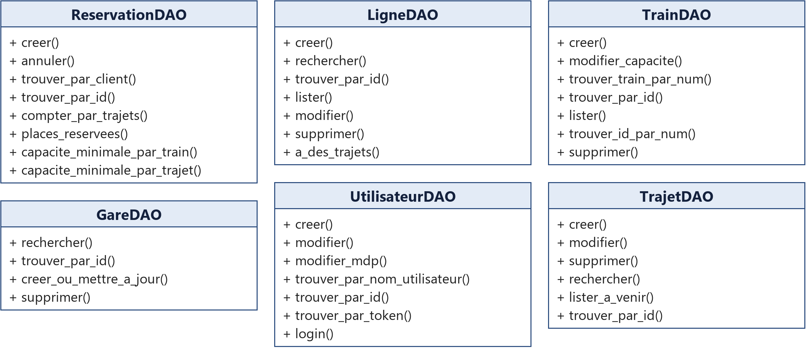
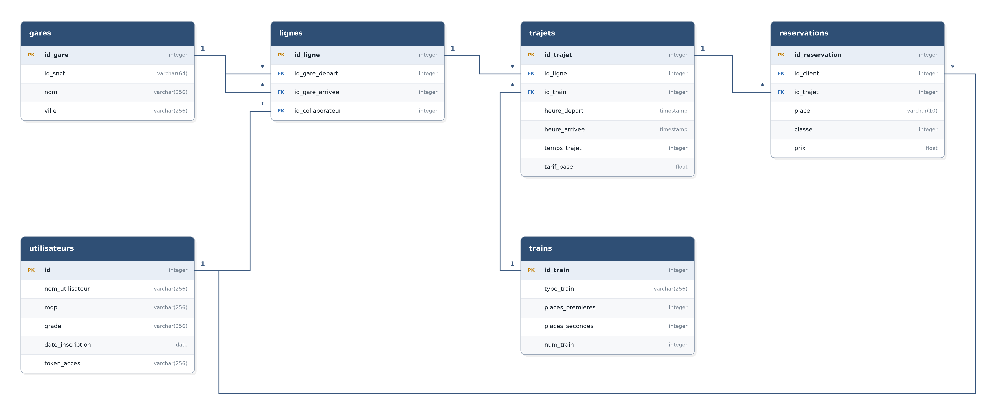
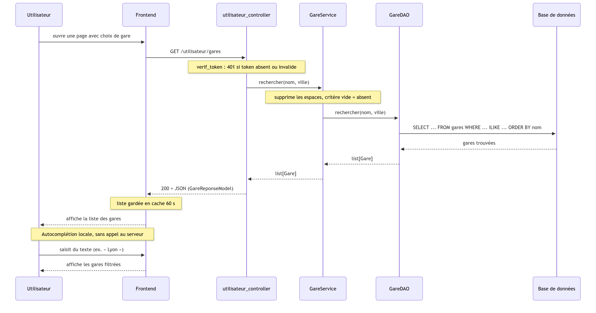
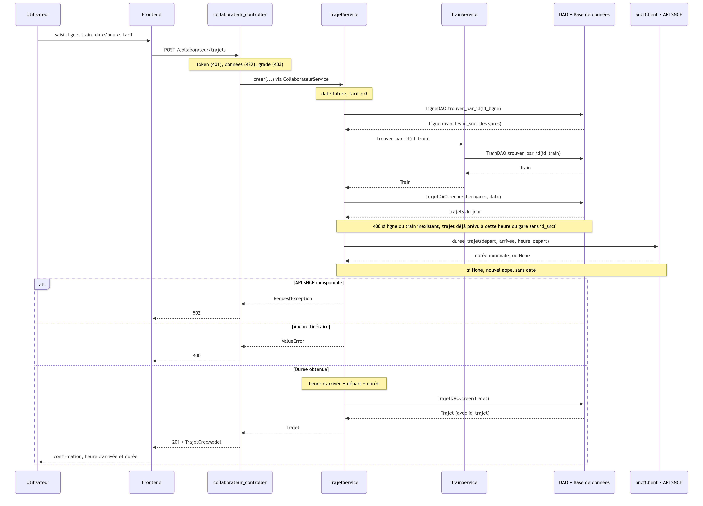

---
format:
  pdf:
    toc: false
    fontsize: "12pt"
    fig-cap-location: bottom
    include-in-header:
      text: |
        \usepackage{graphicx}
    geometry:
      - top=30mm
      - left=25mm
      - right=25mm
      - bottom=30mm
execute:
  echo: false
  warning: false
editor:
  markdown:
    wrap: 72
lang: fr
---

\begin{titlepage}
\centering


% Logo
\includegraphics[width=6cm]{images/ensai-logo.png}\par

\vspace{1.5cm}

% Titre principal
{\Huge Rapport final - Projet informatique \par}
\vspace{0.5cm}
{\Large 2A \par}

\vspace{1.5cm}

% Sous-titre / Nom de l'application
{\LARGE \textbf{Concurrent SNCF} \par}

\vspace{1cm}

% Bloc Étudiants (aligné à gauche)
\begin{flushleft}
\large
\textbf{Étudiants :}\\
Adam BENAMER\\
Satya KREMER\\
Nathan TIATIA\\
Laurine LEROY\\
Lou-Ann CLEMENT\\
Nour NSIRI
\end{flushleft}

\vspace{0.05cm}

% Bloc Encadrant
\begin{flushright}
\large
\textbf{Encadrant pédagogique :}\\
KEVIN LEROY
\end{flushright}


\vfill

% Année universitaire
{\normalsize Année universitaire 2026--2027 \par}

\end{titlepage}
\tableofcontents
\pagenumbering{arabic}
\newpage

# Introduction

Dans un monde exigeant une grande mobilité des personnes et des biens, se déplacer est devenu un enjeu majeur pour tous et toutes. Cependant, ces déplacements viennent souvent à l’encontre de préoccupations environnementales grandissantes. En effet, les trajets en avion ou même en voiture sont extrêmement polluants : il est donc pertinent de se pencher sur une de leurs alternatives la plus verte, c’est-à-dire le train. En effet, le train est une industrie inestimable pour faire face aux enjeux climatiques de notre monde. Ainsi, il est tout aussi nécessaire d’avoir des services qui font fonctionner la concurrence, afin de permettre aux utilisateurs des chemins de fer d’avoir la meilleure expérience possible. C’est pour cette raison que la création d’un concurrent à la SNCF s’impose comme un sujet particulièrement important, et demandant un traitement attentif et complet.

Afin d’accomplir cela, nous avons développé une application qui vise à mettre en place le plus grand nombre possible de fonctionnalités proposées par la SNCF : ce rapport vise donc à expliquer dans le détail comment cette application a été conçue, structurée et codée par notre équipe. Nous verrons dans un premier temps le contexte de l’application et le cahier des charges dressé, ainsi que l'organisation de travail mise en place au sein de l'équipe. Puis nous nous pencherons sur la modélisation de notre application et son architecture générale. Nous nous intéresserons ensuite à l'implémentation, notamment par le biais de diagrammes de séquence, afin d’expliciter les différentes couches de code mises en place et leurs interactions. Nous verrons aussi à cette occasion les outils utilisés et les tests mis en place dans une démarche d'assurance-qualité. Enfin, lors d'une dernière partie de prise de recul nous verrons les possibles modifications à notre application selon différents scénarios.

\pagebreak

# I. Présentation du projet

## 1.  Cahier des charges et fonctionnalités de l'application

Au cours de ce semestre, nous avons donc développé une application qui cherche à approcher au mieux les fonctionnalités proposées par la SNCF. Celles-ci sont constituées de cinq fonctionnalités de base et deux fonctionnalités optionnelles. L’API SNCF nous fournit les gares et les temps de trajet ; les lignes, les trains, les trajets, les prix et les réservations sont propres à notre application. La récupération, l’exploitation et la transmission à notre base de données de ces données SNCF seront explicitées lors de l’explication des couches de code.

La première fonctionnalité est une fonctionnalité de gestion des comptes utilisateurs, afin d’avoir les différents niveaux d’habilitation nécessaires à l’application. Ceux-ci sont au nombre de trois : les administrateurs sont les seuls à pouvoir changer le niveau d’habilitation d’autres comptes, mais ont accès à toutes les autres fonctionnalités accessibles aux deux autres catégories de compte, les collaborateurs et les clients. Tandis que les collaborateurs peuvent créer des lignes et trajets ainsi que lister les lignes, trains et trajets créés, les clients ne peuvent que rechercher ces trajets et les réserver.

La deuxième fonctionnalité demandée est celle de gestion des lignes d’exploitation. Cela est effectué par les comptes collaborateurs, en utilisant l’API externe de la SNCF. Pour faire cela, les collaborateurs importent d’abord des gares existantes depuis l’API SNCF. Ils choisissent ensuite deux de ces gares pour créer une ligne, qu’ils peuvent modifier ou supprimer.

La troisième fonctionnalité que nous devons implémenter est celle de gestion des trajets proposés. Un trajet se trouve sur une ligne, et possède donc une date et une heure de départ et un tarif. Le temps de trajet est calculé avec l’API SNCF, tandis que le nombre de places est celui du train choisi par le collaborateur. En plus de cela, notre code vérifie que la ligne existe et, grâce à l’API SNCF, qu’un trajet en train est possible entre les deux gares. Enfin, les comptes collaborateurs sont capables de modifier ou bien de supprimer un trajet.

La quatrième fonctionnalité est celle de recherche de trajet : un compte client peut rechercher les trajets créés grâce à la fonctionnalité précédente, en entrant une gare de départ et une gare d’arrivée, et éventuellement un jour. À l’issue de cette recherche, toutes les informations nécessaires lors de la création d’un trajet sont visibles par le client, en plus du nombre de places restantes et du tarif.

La cinquième et dernière fonctionnalité est une fonctionnalité de positionnement commercial, laissée libre. Nous avons choisi d’implémenter la tarification transparente : ainsi, dès la recherche d’un trajet, un client peut voir les différentes composantes du prix total. Nous affichons aussi dans la recherche le nombre de places restantes dans chaque classe (première ou deuxième).

De plus, nous avons aussi développé les deux fonctionnalités optionnelles proposées par le sujet : celle des classes de voyage, et la fonctionnalité de réservation. Cette dernière permet à un compte client de réserver et annuler une réservation, ainsi que de visualiser ses réservations.

## 2.  Organisation de l'équipe

L’organisation du groupe a été prise en charge par Lou-Ann Clement en tant que cheffe de projet, tandis que les questions purement techniques portant sur le code étaient gérées par Satya Kremer, le tech leader du groupe.

Les tâches étaient réparties lors de réunions de travail : lors de la phase d'analyse les diagrammes et parties du rapport ont été attribuées lors de ces réunions, et lors de la partie code plusieurs réunions ont eu lieu pour répartir les tâches. Au début, celles-ci se présentaient sous la forme de classes à coder à travers plusieurs couches, et au fur et à mesure de l'avancement du projet ces tâches étaient des erreurs ou corrections remarquées par des membres de l'équipe, et distribuées à tous selon les capacités techniques de chacun. Pour améliorer la communication et la collaboration du groupe en dehors de ces réunions, un groupe Whatsapp a été utilisé régulièrement, ainsi qu'un Google Drive pour centraliser diagrammes et retours du tuteur notamment.

\pagebreak

# II. Modélisation

## 1.  Architecture globale

L'arborescence du code est présentée en annexe 1.

.png){fig-align="center" width="80%"}

Notre application repose sur quatre couches qui interagissent entre elles :

- la couche de présentation (presentation layer), c'est-à-dire l'interface utilisateur (la seule avec laquelle l’utilisateur interagit) : le front end ou le Swagger ;
- le backend, qui contient la couche métier (business layer), les contrôleurs, la couche service et la couche DAO ;
- la couche de persistance : la base de données ;
- la couche Webservices : l'API SNCF, composant externe.

## 2.  Modélisation du backend

Voici plus en détail les classes des différentes couches du backend :

{fig-align="center" width="100%"}

{fig-align="center" width="100%"}

{fig-align="center" width="100%"}

### La couche métier

En premier lieu, les objets métier modélisent les trains, les gares, les lignes, les trajets proposés sur l’application, ainsi que les utilisateurs et leurs réservations. Ils traversent toutes les autres couches qui, elles, servent à gérer ces objets. La gestion du grade (client, collaborateur ou administrateur) se fait via l’attribut `grade` d’`Utilisateur` plutôt que par trois classes filles emboîtées. Cela facilite les changements de grade faits par les administrateurs ainsi que la gestion des accès différenciés aux fonctionnalités.

### Les controllers

Les controllers reçoivent les requêtes HTTP du front end, et les transmettent à la couche service. Ils gèrent aussi l’authentification et la vérification du grade des utilisateurs. Les schémas (dans le dossier `schema/`) fixent le format des requêtes utilisateurs et des réponses qui lui sont renvoyées.

### La couche service

La couche service regroupe les méthodes qui permettent de gérer les objets métiers. Chaque objet a sa classe service correspondante, avec des méthodes permettant de créer, modifier, supprimer l’objet ainsi que des méthodes spécifiques à chaque objet. De plus, il y a des classes service pour chaque profil d’utilisateur : `UtilisateurService`, `CollaborateurService` et `AdministrateurService`, qui permettent de séparer et d’identifier les fonctionnalités supplémentaires selon le profil. Un autre point important de la couche service est l’utilisation de l’API : elle est la seule à faire appel à `SncfClient`, d’abord dans `GareService` pour importer les gares  puis dans `TrajetService` pour vérifier qu’un trajet ferroviaire est possible entre les deux gares et, le cas échéant, calculer la durée d’un trajet.

### La couche DAO

La couche DAO est celle qui interagit avec la base de données. Elle donne accès aux informations stockées dans celle-ci et y enregistre les informations créées à partir de l’application. Chaque objet a sa classe DAO correspondante, qui contient les mêmes types d'opérations (créer, modifier, supprimer, rechercher, trouver par identifiant). Leurs méthodes renvoient directement des objets métiers qu’elles reconstituent à partir des informations de la base de données.

### Les utilitaires (dossier `utils`)

La classe `DBConnexion` dans le fichier `utils/db_connexion.py` est le point d’accès à PostgreSQL. Elle utilise la bibliothèque psycopg2 et lit les informations de connexion à la base de données rangées dans le `.env` (hôte, port, base, utilisateur, mot de passe, schéma). Elle utilise un `Singleton` (`utils/singleton.py`) pour garantir que l'application ne partage qu'une seule connexion à la base. La classe `SncfClient` regroupe tous les appels à l’API SNCF.

Le fichier `securite.py` contient le hachage des mots de passe, la vérification du token et celle du grade. Enfin, `log_utils.py` gère les logs, `env_var.py` charge le fichier `.env` et `reset_bdd.py` réinitialise la base de données. Les questions de sécurité associées à ces connexions et comptes utilisateurs sont développées dans la suite de ce rapport.


## 3.  Base de données

### Rôle de la base de données dans l'application

Notre application s'appuie sur deux sources de données : l'API de la SNCF et une base de données PostgreSQL. L’un des premiers choix de conception du projet a donc été de répartir la tâche entre l’API et la base de données sans que l’un n’empiète sur l’autre. D’une part, l'API SNCF permet à l’application de récolter les informations de base sur les gares (nom, ville, id) et la durée des itinéraires entre deux gares notamment avec les endpoints. En revanche, elle n’est pas adaptée à notre application. En effet, elle ne connaît en rien ce qui est propre à notre application : les comptes utilisateurs, les trains de notre application, les lignes ouvertes par les collaborateurs, les trajets ainsi que les réservations des clients. Puisque ces données n'existent que chez nous, il nous faut les conserver dans la base de données. Nous avons également choisi d'enregistrer les gares en base, même si elles sont disponibles via l'API. Lorsqu'un collaborateur importe des gares, la couche service interroge l'API SNCF, puis enregistre les gares trouvées au sein de notre base de données. Les recherches sont ensuite faites directement dans notre base.

La conception de la base de données nous a fait enregistrer les gares dans la base de données pour deux raisons. La première est en rapport direct avec l’autocomplétion et la complexité de cette dernière. Lorsque l'utilisateur recherche une gare, des propositions doivent apparaître pour compléter la recherche. Le fait d'interroger l'API SNCF à chaque lettre consommerait beaucoup de requêtes et rendrait notre interface dépendante de la rapidité d'un service externe. Cela est d’ailleurs en rapport avec la deuxième raison de ce choix. Cette décision porte sur la résilience de notre application. En effet, une fois que l’on importe les gares depuis l’API, ces dernières sont stockées dans la base et l’application peut fonctionner (recherche de gares, consultation des trajets, réservations), même lorsque l’API n’est pas disponible. Néanmoins, ce choix comporte une limite. Une gare qui n'est pas dans la base doit obligatoirement être importée depuis l’API. Si celle-ci est indisponible, l’utilisateur ne peut pas ajouter une nouvelle gare.

### Conception des tables

{fig-align="center" width="80%"}

Le schéma de notre base de données comporte six tables qui correspondent aux six objets métier définis pour notre application :

- gares : les gares importées depuis l'API SNCF, identifiées en interne par `id_gare` et rattachées à l'API par `id_sncf`.
- utilisateurs : les comptes de l'application, avec leur grade (ADMIN, COLLABORATEUR ou CLIENT).
- lignes : une liaison entre une gare de départ et une gare d'arrivée, rattachée au collaborateur qui l'a créée.
- trains : l’objet permettant de faire des trajets, avec sa capacité en première et en seconde classe.
- trajets : un départ programmé sur une ligne, avec un train, des horaires et un tarif de base.
- réservations : réservation d'une place, dans une classe donnée, par un client sur un trajet.

Ces tables reprennent les objets métier présentés dans le diagramme de classes. Chaque table correspond à une classe et à une DAO, ce qui rend le passage de la base aux objets direct et facile à suivre.

Nous avons délégué une partie des règles nécessaires à notre application à PostgreSQL lui-même, au moyen de contraintes. Une règle vérifiée par la base s'applique quel que soit le chemin emprunté par la donnée et ne peut pas être contournée par un oubli dans le code.

- Clés primaires (SERIAL) : chaque enregistrement reçoit un identifiant unique généré par la base, que la DAO récupère.
- Clés étrangères : une ligne ne peut relier que des gares qui existent, un trajet ne peut utiliser qu'une ligne et un train existants, et une réservation doit porter sur un client et un trajet réels.
- Contraintes d'unicité (UNIQUE) : pour les réservations, une même place ne peut pas être réservée deux fois sur un même trajet. Dans le cas où deux clients tenteraient de réserver la même place, la base refuserait la requête la plus tardive. La couche service intercepte alors l'erreur et la transmet à l’utilisateur. Pour ce qui est des utilisateurs, deux comptes ne peuvent pas porter le même nom, ce qui garantit qu'une connexion désigne un seul et unique compte. Un numéro de train et une gare SNCF n'existent qu'une fois dans la base de données.
- Valeurs obligatoires sur les champs qui sont indispensables pour un compte (nom, mot de passe, grade).

Les clés étrangères imposent un ordre de création. C’est-à-dire qu’une table ne peut faire référence qu'à une autre table qui existe déjà. Pour la conception nous avons donc décidé de créer d'abord les tables qui ne dépendent d'aucune autre (gares, utilisateurs, trains), puis lignes, qui dépend des gares et des utilisateurs, puis trajets, qui dépend des lignes et des trains, et enfin réservations, qui dépend des trajets et des utilisateurs. Cet ordre suit directement les flèches du diagramme de la base de données.

### Initialisation et réinitialisation de la base

La base est décrite dans trois fichiers SQL, situés dans le dossier `data/` :

- `init_bdd.sql` crée les six tables avec leurs contraintes ;
- `admin.sql` crée trois comptes pour démontrer les fonctionnalités par grade (administrateur, collaborateur, client). Leurs mots de passe sont stockés sous forme hachée, comme pour un compte créé depuis l'application ;
- `donnees_demo.sql` ajoute un jeu de données de démonstration : gares, lignes, trains, trajets et réservations. Les dates des trajets sont calculées à partir du jour de l'initialisation, afin qu'il y ait toujours des trajets à venir.

Comme tout est décrit dans ces fichiers, n'importe quel membre de l'équipe peut recréer une base identique à partir de zéro.
La classe Reset_bdd permet d’automatiser cette réinitialisation. C’est-à-dire qu’elle supprime le schéma de travail, le recrée, puis exécute les trois fichiers cités précédemment. Via l'API, cette opération est réservée aux administrateurs. La réinitialisation nous aura été utile tout au long du développement du code de l’application. Elle nous permet d'effectuer plusieurs tests manuels, de corriger rapidement une base devenue incohérente et de préparer un environnement propre avant une démonstration.

### Sécurité des données

Le code permet de protéger les identifiants de connexion. Les informations qui permettent de se connecter à la base de données sont stockées dans un fichier `.env`, chargé au démarrage du backend. Ce fichier est listé dans le `.gitignore` du projet et n'est donc jamais publié sur le Git. De plus, aucun mot de passe de la base de données n'apparaît dans le code source. Les mots de passe ne sont jamais stockés en clair. Ils sont hachés avec, comme sel, le nom d'utilisateur : deux utilisateurs ayant le même mot de passe obtiennent donc des empreintes différentes. À la connexion, le mot de passe saisi est haché de la même façon, puis comparé à sa version hachée.

Le code est aussi protégé contre les injections SQL. Toutes les requêtes des DAO sont paramétrées. Cela signifie que les valeurs saisies par l'utilisateur ne sont jamais ajoutées au texte de la requête. Elles sont transmises séparément, par des paramètres comme `%(nom)s`, et c'est psycopg2 qui se charge de les insérer en échappant les caractères dangereux d’une possible requête SQL non-voulue. Même si un utilisateur saisit du code SQL dans le champ de recherche d'une gare, ce code est traité comme un simple texte et n'est jamais exécuté.


# III. Implémentation

## 1. Principes communs à toutes les fonctionnalités

### Authentification et gestion des profils

Toutes les fonctionnalités reposent avant tout sur l’authentification des utilisateurs.

#### Création de compte

Lors de la création d’un compte, le controller vérifie que le nom et le mot de passe sont bien renseignés, puis le service vérifie que le nom n'est pas déjà pris. Un nouveau compte est toujours un compte client : c'est `UtilisateurService.creer_compte()` qui impose le grade, peu importe ce que contient la requête. De plus, le mot de passe n'est jamais stocké en clair : il est haché par cette même méthode avec, comme sel, le nom d'utilisateur, ce qui permet de donner des empreintes différentes pour deux utilisateurs ayant le même mot de passe.

#### Changement de mot de passe

`UtilisateurService.changer_mdp()` exige l’ancien mot de passe. L’empreinte de ce dernier est donc vérifiée avant d’enregistrer la nouvelle empreinte (le nouveau mot de passe haché avec le nom d’utilisateur comme sel).

#### Connexion

`UtilisateurService.login()` compare l'empreinte du mot de passe saisi à celle de la base. Si elles correspondent, le service génère un token aléatoire (`secrets.token_urlsafe(32)`), qui est ensuite enregistré sur l’utilisateur dans la base, puis renvoyé avec l’identifiant, le nom et le grade de l’utilisateur. Une nouvelle connexion remplace le token précédent.


Pour toutes les autres fonctionnalités, l’identité d’un utilisateur est toujours déduite par ce token de connexion. En effet, celui-ci est envoyé dans l’en-tête HTTP par le front end ou le Swagger, puis la dépendance FastAPI `verif_token` retrouve l’utilisateur correspondant via `UtilisateurDAO`. C’est un point de sécurité important car cela implique qu’un client ne peut pas, par exemple, supprimer la réservation d’un autre client. Le controller vérifie ensuite que le grade de l'utilisateur est suffisant pour la fonctionnalité concernée.

### Gestion des erreurs

Pour toutes les fonctionnalités, les erreurs levées par les services ou les DAO sont traduites en code HTTP par les controllers. Ce code est retourné à l’utilisateur, signalant la cause de l’erreur :

- 401 : non connecté (le token est absent ou invalide),
- 403 : grade insuffisant,
- 400 : donnée invalide ou règle métier non respectée,
- 404 : ressource introuvable,
- 422 : donnée mal formée, refusée par Pydantic,
- 502 : API SNCF indisponible.

## 2. Implémentation des fonctionnalités clés

Nous allons désormais détailler les choix d’implémentation des fonctionnalités centrales de notre application.
Nous avons choisi de détailler davantage certaines fonctionnalités qui étaient caractéristiques de la mobilisation des différentes couches de l'application, ou pour mettre en valeur les spécificités d'une fonctionnalité.

### Recherche sur l’application

Tous les utilisateurs ont la possibilité de rechercher des gares et des trajets sur l’application, après connexion.

#### Recherche d’une gare

La recherche de gare est une fonctionnalité clé dans notre application. Nous avons choisi de détailler son implémentation car c'est une fonctionnalité ouverte à tous les profils, et qui permet d'illustrer simplement le fonctionnement des couches et le lien avec notre base de données.

Une gare ne peut être trouvée que si elle a été, au préalable, importée depuis l'API SNCF par un collaborateur. Dans notre application, chaque gare possède un identifiant, un nom, une ville et son identifiant SNCF. L'utilisateur, lui, ne peut pas manipuler ces identifiants. Il saisit tout simplement le début d'un nom de gare ou de ville, par exemple « Lyon » pour obtenir Lyon Part-Dieu, Lyon Perrache et les autres gares lyonnaises.

{fig-align="center"}


Contrairement à la création d'un trajet, ce diagramme ne fait apparaître ni l'API SNCF ni aucune écriture : la requête descend jusqu'à la base de données par une simple lecture, puis la liste des gares remonte jusqu'à l'interface. La dernière partie du diagramme montre que l'autocomplétion se déroule ensuite entièrement dans l'interface, sans nouvel échange avec le serveur.

**Frontend.** Dans le frontend, on choisit une gare selon une liste de gares où l’utilisateur peut filtrer par ville ou nom de gare, chaque gare étant affichée avec sa ville. Comme nous l’avons précisé, pour que cette autocomplétion reste fluide avec une interface qui ne sollicite pas le serveur à chaque lettre tapée, elle demande une seule fois la liste complète des gares puis filtre localement à mesure que l'utilisateur écrit. Lorsqu'un collaborateur importe de nouvelles gares, les gares importées apparaissent immédiatement dans les listes. Le Swagger, lui, permet d'appeler directement la route de recherche avec un début de nom ou de ville.

**Couche contrôleur.** La requête arrive sur la route GET /utilisateur/gares, avec deux paramètres facultatifs : nom et ville. Comme pour la création de trajet, la fonction verif_token lit le token transmis dans l'en-tête X-Auth-Token et retrouve l'utilisateur correspondant en base. Si le token est absent ou non-connu, la requête s'arrête avec le code 401. Ici, peu importe le grade : tout utilisateur connecté peut rechercher une gare (client, collaborateur, administrateur). La couche contrôleur transmet seulement les deux critères à GareService, puis renvoie le résultat. Le schéma Pydantic GareReponseModel fixe le format de la réponse avec un identifiant, un nom, une ville et un identifiant SNCF. Une recherche qui n’aboutit à aucun résultat renvoie simplement une liste vide avec le code 200.

**Couche service.** GareService.rechercher prépare les critères de recherche : les espaces en début et en fin de saisie sont supprimés, et un critère vide est traité comme absent. Dans le cas où aucun critère n'est renseigné, toutes les gares sont renvoyées, ce qui est précisément ce dont l'interface a besoin pour son autocomplétion. Le service n'appelle volontairement pas l'API SNCF à ce stade. Nous avons choisi ici de faire une recherche rapide et qui ne consomme pas de requêtes auprès de l’API, lui permettant ainsi de fonctionner même si l’API SNCF est indisponible.

**Couche DAO.** GareDAO.rechercher exécute une seule requête SQL sur la table gares. Chaque critère est facultatif puisqu'une même requête couvre la recherche par nom, par ville, par les deux, ou sans critère. La comparaison utilise l'opérateur ILIKE, insensible à la casse. Ainsi, taper « paris » ou « PAR » donne le même résultat. Les gares sont triées par nom pour que cela soit davantage lisible pour l’utilisateur. Comme toutes nos requêtes, celle-ci est paramétrée et protège contre les injections SQL, comme expliqué précédemment. Enfin, le DAO transforme chaque résultat en objet Gare. Le constructeur vérifie le type des valeurs reçues, ce qui garantit la cohérence des objets dans l'application.

**Base de données.** Les gares sont ajoutées par un collaborateur, depuis la page « Gares » du frontend, qui appelle la route POST /collaborateur/gares/importer. Le contrôleur vérifie le grade de l’utilisateur, et si ce dernier n’est pas collaborateur, renvoie une erreur 403. GareService.importer exige au moins deux caractères de recherche (renvoie une erreur 400 sinon), pour éviter des listes de gares trop importantes. Le service appelle alors l’API SNCF. Pour chaque résultat, l’API renvoie le nom de la gare, son identifiant SNCF et sa commune. Chaque gare est ensuite enregistrée par GareDAO.creer_ou_mettre_a_jour, qui s'appuie sur la contrainte d'unicité de l'identifiant SNCF. Une gare ne peut donc pas être enregistrée en double : si ses informations ont changé, elle est mise à jour. Par exemple, importer deux fois la gare de Massy-Palaiseau ne crée aucun doublon. Si l'API est indisponible, l'erreur remonte jusqu'à la couche contrôleur, qui renvoie 502. Avec cet identifiant SNCF, conservé en base, l’API et ses endpoints permettent ensuite de calculer la durée d’un trajet lors de sa création.

La recherche renvoie la liste des gares correspondantes, triée par nom, avec le code 200. Chaque erreur est traitée par la couche la plus proche de sa cause : 401 pour un utilisateur non connecté, 403 pour un import tenté par un client, 400 pour une saisie trop courte lors d’un import, 404 pour une gare introuvable lors d'une recherche de trajets, et 502 lorsque l'API SNCF ne répond pas pendant un import.

| Situation | Code |
|--------------------------------------------------------------|----------|
| Recherche réussie, même sans résultat (liste vide) | 200 |
| Utilisateur non connecté ou token invalide | 401 |
| Import tenté par un client | 403 |
| Texte d'import de moins de deux caractères | 400 |
| API SNCF indisponible pendant un import | 502 |

: Situations possibles lors de la recherche et de l'import de gares

Ce cheminement permet de montrer un choix de conception important : séparer ce qui alimente les données de ce qui permet de les consulter. L'API SNCF n'est sollicitée qu'au moment de l'import par un collaborateur. Toutes les recherches se font ensuite avec notre base. L'application reste ainsi rapide et peu dépendante d'un service externe, et l'autocomplétion fonctionne même lorsque l'API est indisponible. Enfin, chaque couche garde son rôle : l'interface gère l'ergonomie de la saisie, le contrôleur l'authentification, le service la préparation des critères et le DAO la requête SQL.

#### Recherche d’un trajet

Pour rechercher un trajet, l’utilisateur doit renseigner deux gares (le jour est optionnel). La fonction `trouver_gare()` du controller utilisateur retrouve chaque gare à partir de son nom, grâce à `GareService.rechercher()`. Puis `TrajetService.rechercher()` appelle `TrajetDAO.rechercher()`, qui renvoie les trajets du jour choisi ou, sans date, tous les trajets à venir. Le service ajoute enfin à chaque trajet ses places restantes et le détail de son prix.


### Gestion des réservations

Tous les utilisateurs peuvent réserver une place pour un trajet choisi, annuler une réservation et consulter l’historique de leurs réservations.

#### Réserver une place

L'utilisateur choisit un trajet, une classe et, s'il le souhaite, un numéro de place. Après avoir vérifié que la classe est valide et que le trajet n'est pas déjà parti, `ReservationService.creer()` détermine la place :

- Sans numéro, `_attribuer_place()` retient la première place libre renvoyée par `TrajetService.places_libres()` ;

- Avec un numéro, `_verifier_place()` contrôle que la classe n'est pas complète et que le numéro ne dépasse pas sa capacité.

Les places restantes ne sont pas stockées : elles sont recalculées à partir de la capacité du train et des réservations existantes, ce qui évite d'avoir un compteur à tenir à jour. Le prix est calculé par le module tarification (tarif de base, multiplié par 1,5 en première classe), puis enregistré avec la réservation : une modification ultérieure du tarif ne change donc pas le prix d'un billet déjà réservé.

Enfin, une contrainte d'unicité en base sur le trajet, la classe et la place garantit qu'une même place ne peut pas être réservée deux fois, même si deux clients la demandent presque simultanément. Dans ce cas, le second reçoit une erreur 400 s'il avait choisi sa place ; sinon, le service lui en attribue une autre.


#### Annuler une réservation

La méthode `ReservationService.annuler()` vérifie à la fois que la réservation existe, qu’elle appartient bien au client connecté, et que le trajet n'est pas déjà parti.

#### Consulter l’historique de ses réservations

`ReservationService.historique_par_client()` renvoie toutes les réservations de l'utilisateur connecté. L'interface les sépare ensuite entre voyages à venir et voyages passés.


### Gestion du réseau par un collaborateur


#### Import de gares

Les gares sont importées par les collaborateurs depuis l’API SNCF. Lorsqu’un collaborateur veut importer une gare, il renseigne le nom ou la ville de la / des gares qu’il cherche. `GareService.importer()` demande à `SncfClient` les gares correspondantes, puis fait appel à la DAO qui enregistre ou met à jour la ou les gares renvoyées. Ainsi, si un collaborateur entre le nom d’une ville, toutes les gares de la ville sont importées dans notre base.

#### Création d’une ligne

Le collaborateur doit saisir deux gares contenues dans notre base de données pour créer une ligne entre elles. La ligne est rattachée au collaborateur, identifié par le token. Une ligne ne peut être ni modifiée ni supprimée tant qu'elle porte des trajets.

Le collaborateur peut aussi lister toutes les lignes, tous les trains et tous les trajets à venir, ce qui lui permet de choisir celui qu'il veut modifier ou supprimer.

#### Création d'un trajet

Nous avons décidé de présenter l’implémentation de cette fonctionnalité de manière détaillée, puisqu’elle est centrale dans notre application et permet d’illustrer la combinaison entre la base de données et l’API SNCF.
Cette fonctionnalité fait intervenir la base de données, en lecture comme en écriture, l'API SNCF et toutes les couches de l'application. C'est la seule qui combine des données internes et un service externe pour produire une nouvelle donnée.

Un trajet s'appuie sur des éléments qui existent déjà : des gares importées depuis l'API SNCF, avec leur identifiant SNCF, une ligne qui relie deux de ces gares, et un train avec ses capacités en première et en seconde classe. Le collaborateur ne saisit donc que quatre informations : la ligne, le train, la date et l'heure de départ, et le tarif de base. L'heure d'arrivée et la durée du trajet ne sont pas saisies. Elles sont calculées par l'application, ce qui évite qu'un collaborateur enregistre un horaire incohérent.

{fig-align="center"}


**Couche contrôleur.** Le formulaire envoie une requête POST /collaborateur/trajets. Avant même d'entrer dans notre code, FastAPI valide le corps de la requête avec le schéma Pydantic TrajetCreationModel : les identifiants doivent être des entiers, l'heure de départ une date avec heure et le tarif un nombre. Une donnée mal formée, par exemple un tarif écrit en lettres, est rejetée automatiquement avec le code 422, sans qu'aucune ligne de notre code ne s'exécute. La fonction verif_token lit ensuite le token transmis afin de retrouver l'utilisateur connecté. Dans le cas où le token est absent ou invalide, on arrête la requête avec le code 401. Enfin, le contrôleur vérifie que cet utilisateur a au moins le grade collaborateur. Étant donné que les grades sont hiérarchiques, un administrateur peut donc aussi créer un trajet, tout comme un collaborateur. Un client, dont le grade n'est pas suffisant, reçoit un code erreur 403.

**Couche service.** C'est dans TrajetService.creer que se trouvent les règles, et les vérifications s'y font dans un ordre précis. Dans un premier temps, la couche service vérifie la validité des données : la ligne et le train sont renseignés, la date de départ est située dans le futur, puisqu'un trajet passé ne pourrait jamais être réservé, et le tarif de base est positif ou nul. Par la suite, elle vérifie que la ligne et le train existent en les chargeant depuis la base. Si l'un des deux n'existe pas, la création est refusée. Elle s'assure enfin qu'aucun trajet ne part déjà à la même heure entre les deux mêmes gares ce jour-là, pour éviter les doublons : un départ à la même heure est refusé. Ce n'est qu'après ces trois contrôles que le service interroge l'API SNCF. L'itinéraire le plus rapide est retenu. Si l'API ne connaît pas encore les horaires à cette date, la requête est refaite sans date, et la durée retenue est celle des horaires actuels. Si aucun itinéraire n'existe, la création est refusée : on ne planifie que des trajets réalisables en train. Une fois la durée obtenue, le service calcule l'heure d'arrivée (départ + durée), convertit la durée en minutes et construit l'objet Trajet, qu'il transmet à la couche DAO pour l'enregistrer.

**Couche DAO.** Trois classes DAO interviennent. LigneDAO.trouver_par_id charge la ligne complète : une jointure entre les tables lignes et gares reconstruit l'objet Ligne avec ses deux objets Gare, identifiants SNCF compris. Grâce à cette jointure, le service dispose en une seule requête de tout ce dont il a besoin pour interroger l'API. Pour le contrôle de doublon, TrajetDAO.rechercher renvoie les trajets du jour entre les deux gares. Enfin, TrajetDAO.creer insère le trajet dans la table trajets et récupère son identifiant grâce à RETURNING id_trajet. Le service place cet identifiant dans l'objet.

**Couche du client de l'API SNCF.** Le service transmet à `SncfClient` les identifiants SNCF des deux gares et l'heure de départ. `SncfClient` interroge le point d'accès `journeys` de l'API, qui propose plusieurs itinéraires, et retient le plus rapide. L'API ne publie les horaires que sur quelques semaines. Comme dit précédemment, si elle n'en a pas encore pour la date demandée, la requête est refaite sans date : un collaborateur peut ainsi planifier un trajet plusieurs mois à l'avance. Dans le cas où aucun itinéraire n'existe, ou si l'une des gares n'a pas d'identifiant SNCF, la création est refusée avec le code 400 (comme dit ci-dessus). Si l'API est indisponible, ou si le token d'accès à l'API n’est pas disponible dans la configuration du serveur, l'erreur remonte jusqu'au contrôleur, sous forme d’erreur 502. Dans ce cas, l'erreur vient d'un service extérieur, et non de la requête du collaborateur.

Si tous les contrôles passent, le contrôleur répond 201 avec l'identifiant du trajet, l'heure d'arrivée et la durée calculée. L'interface les affiche au collaborateur, qui voit ainsi immédiatement le résultat du calcul et peut le vérifier.

| Situation | Code |
|--------------------------------------------------------------|----------|
| Trajet créé | 201 |
| Donnée mal formée | 422 |
| Utilisateur non connecté ou token invalide | 401 |
| Grade insuffisant (client) | 403 |
| Date passée ou tarif négatif | 400 |
| Ligne ou train inexistant | 400 |
| Trajet déjà prévu sur cette ligne à la même heure | 400 |
| Aucun itinéraire en train entre les deux gares | 400 |
| API SNCF indisponible | 502 |

: Situations possibles lors de la création d'un trajet

Ce parcours illustre plusieurs choix de conception. Chaque couche garde son rôle : l'interface gère la saisie, le contrôleur le protocole et les droits, les services appliquent les règles et orchestrent, les DAO accèdent aux données. Les appels à l'API externe sont regroupés dans `SncfClient` : si l'API change, seule cette classe est modifiée. Enfin, l'ordre des opérations est pensé : vérifications locales, puis appel externe, puis écriture. Aucune écriture n'a lieu si un contrôle échoue, ce qui garantit que la base ne contient jamais de trajet incomplet ou incohérent.


### Gestion des comptes par l'administrateur

#### Recherche de compte par identifiant ou par nom

Cette possibilité de recherche peut permettre à l’administrateur de consulter, par exemple, le grade d’un utilisateur, s’il souhaite par la suite le modifier.

#### Modification du grade d’un utilisateur

L’administrateur peut renseigner un nouveau grade pour un utilisateur (CLIENT, COLLABORATEUR ou ADMIN). `AdministrateurService.gerer_habilitation()` refuse un grade invalide, un compte inexistant, et toute modification du grade d'un administrateur. De cette façon, un administrateur ne peut pas “dégrader” un autre administrateur.


## 3.  Tests

Nos tests servent à vérifier que chaque fonctionnalité respecte les contraintes définies dans le dossier d’analyse tout en détectant les problèmes du code lorsque celui-ci évolue. Comme nous l’avons expliqué, l'application est organisée en différentes couches, nous avons testé chaque couche de manière isolée. La classe MagicMock nous permet, comme dans le cas des tests DAO, de simuler les dépendances nécessaires à la réalisation des tests. Cela nous permet de localiser les erreurs dans une couche précise lorsque le test échoue sans confondre une erreur dans une requête SQL avec une erreur de code.

Les tests sont écrits avec l’outil pytest. Le décorateur @pytest.mark.parametrize dans les tests de la couche service, controller ou objets permet de tester plusieurs cas en utilisant une seule fonction : dans le cas de la classe Utilisateur, un même test permet de vérifier qu'un identifiant, un mot de passe, un nom ou un grade qui ne sont pas du type attendu lèvent bien une TypeError avec le message attendu. Le module unittest.mock contenant notamment patch et MagicMock, remplace la base PostgreSQL et l'API SNCF. Enfin, pytest-cov mesure la couverture du code.

La répartition des tests par couche est détaillée en annexe 3.

Pour les DAO, le problème était que faire un test nécessite d’utiliser une base de données. On cherche alors à simuler le “cursor” des classes DAO permettant d’accéder à la base. Cette technique permet de rendre les tests indépendants de la base et reproductibles sur n’importe quelle machine sans besoin de se connecter. Cette technique nécessite tout de même de créer des données factices, que l’on construit uniquement pour les tests. Le curseur simulé renvoie des dictionnaires, exactement comme le vrai curseur. On vérifie alors que le DAO construit correctement les objets métier et qu'il réagit comme prévu aux erreurs de la base. Cette approche est tout de même limitée : elle ne garantit pas que les requêtes SQL s'exécutent correctement sur PostgreSQL. Afin de remédier à ce manque, nous avons vérifié manuellement le parcours complet d’un utilisateur (création de compte, connexion, recherche de trajet, réservation, annulation) sur la base PostgreSQL et avec la vraie API SNCF, via l'interface Swagger.

Le projet compte un total de 446 tests, qui passent tous. La couverture de test du code est de 87 %. Les services métier (trajets, lignes, trains, gares, réservations, tarification), qui sont au cœur de la logique de notre application, sont couverts entre 98 % et 100 %, de même que le client de l'API SNCF et les schémas Pydantic. Les services liés aux utilisateurs sont moins couverts (86 % pour les collaborateurs, 69 % pour les utilisateurs). Les modules les moins couverts sont la partie administrateur (environ 40 %) et la lecture des variables d'environnement (29 %). Cette dernière dépend fortement de l'environnement d'exécution et a surtout été validée par la pratique.


## 4.  Outils utilisés

Le code a été entièrement écrit en Python. L'interface (frontend) utilise la bibliothèque Streamlit et a été codée à l'aide d'IA génératives. Des IA génératives, notamment Claude, ont aussi été utilisées pour une partie du backend, des tests, de la documentation du code et de la relecture de ce rapport. Pour la base de données, nous avons eu recours à PostgreSQL. Enfin, nous avons utilisé tout au long de ce projet un dépôt GitHub en tant qu'outil de versionnage de notre code.

Dans ce code Python, nous avons notamment eu recours à de nombreuses bibliothèques. Nous avons par exemple utilisé pytest pour coder les tests unitaires ou datetime pour simplifier la gestion des horaires des trajets. Pour valider automatiquement le format des requêtes et des réponses de notre API, nous avons eu recours à la bibliothèque pydantic. Pour la construction de notre API, nous avons utilisé fastapi sur Python. Nous avons utilisé psycopg2 comme adaptateur PostgreSQL, pour nous permettre de nous connecter à notre base de données ainsi que d'effectuer des requêtes à celle-ci. La bibliothèque logging nous a permis d'avoir une vision générale des erreurs et autres événements notables sur notre application, afin de nous aider lors des phases de débogage. D'autres bibliothèques ont été utilisées au cours de la programmation de cette application, notamment dotenv, functools, pathlib, hashlib, os, requests et yaml, qui simplifient des aspects plus techniques de la programmation.

# IV. Prise de recul et perspectives

Nous allons à présent voir les possibles modifications qu’il faudrait apporter à notre code selon différents scénarios – que cela soit pour apporter de nouvelles fonctionnalités à l’application ou bien pour changer de source de données.


En effet, la question se pose de savoir si notre application deviendrait complètement inutile si l’API SNCF, notre source de données externes, devait disparaître. En réalité, d’autres sources de données similaires existent, même si celles-ci ne portent pas toutes sur les voies ferrées du territoire français. Plusieurs alternatives existent donc : l’API Navitia.io, dont l’API SNCF est un sous-service, peut notamment donner l’accès à d’autres transports publics, comme ceux de l’Île de France par exemple. D’autres services ressemblant à l’API SNCF existent aussi à l’étranger. Si nous devions donc remplacer l’API SNCF par certaines de ces alternatives, nous n’aurions que certaines couches à modifier. En effet, notre application a été structurée pour que ces modifications ne soient que minimes. Les couches affectées sont donc les couches service, qui interagissent avec les APIs externes, et qui devront donc avoir des requêtes modifiées selon les spécificités de l’API utilisée. Des modifications peuvent aussi avoir lieu dans la couche DAO en lien avec les noms de données utilisées par l’API. De plus, les tokens devront être modifiés, mais la grande majorité de l’application ne serait ainsi pas affectée si l’API SNCF devait disparaître.


La question se pose ensuite de savoir quelles fonctionnalités nous pourrions rajouter à notre code et comment nous ferions ces modifications. Une première fonctionnalité à rajouter pourrait être une fonctionnalité de correspondances, par exemple avec d’autres transports publics. De nouveau, les données de l’API Navitia pourraient nous être utiles, car elles recensent de nombreux réseaux de transports publics sur le territoire français. Pour faire cela, nous pourrions remplacer l’API SNCF par Navitia, avec les modifications proposées précédemment, et nous devrions alors sûrement ajouter une nouvelle fonction qui peut utiliser les fonctions natives de l’API Navitia.


Une autre fonctionnalité à rajouter pourrait être celle des prix dynamiques, remplaçant les prix transparents. En effet, la décomposition des prix serait à supprimer, dans une optique d’éviter la frustration des clients devant des prix gonflés par une forte demande. Nous devrions sûrement ensuite ajouter des modifications à la couche service, qui devrait alors contenir une classe service visant à calculer cette tarification dynamique. Il est aussi possible de modifier la base de données et donc les couches DAO pour ajouter une nouvelle colonne prix payé calculé à partir du prix plancher.


Nous avons aussi pensé à l’ajout d’une carte de réduction. Nous pensons que les modifications à faire ressemblent à celles de l’hypothèse de modification précédente pour ce qui est des prix réduits, mais nous devrions sûrement aussi rajouter une nouvelle classe CarteReduction à travers toutes les couches, qui pourrait alors interagir avec les utilisateurs et les réservations. La base de données devrait aussi s’adapter pour contenir les informations de la carte de réduction.


Enfin, notre application a aussi des limites que nous pourrions corriger. Le token de connexion n’a pas de date d’expiration : il est seulement remplacé à la connexion suivante. De plus, un collaborateur peut changer l’heure d’un trajet déjà réservé sans que les clients en soient prévenus. Une date d’expiration et des notifications amélioreraient donc la sécurité et le service rendu. Du côté de la qualité, les priorités seraient de mieux tester la partie administrateur et d’ajouter des tests automatiques sur une vraie base PostgreSQL.

# Conclusion

Ce projet nous a permis de développer une application complète pour une compagnie ferroviaire concurrente de la SNCF. Les cinq fonctionnalités de base et les deux fonctionnalités optionnelles du sujet sont implémentées : gestion des comptes, des lignes et des trajets, recherche, tarification transparente, places restantes, réservation et classes de voyage.

L’organisation du code en couches est le choix le plus structurant de notre projet. Elle nous a permis de répartir le travail, de tester chaque couche séparément et de limiter l’utilisation de l’API SNCF à deux besoins : récupérer les gares et calculer les temps de trajet. Les données propres à notre compagnie restent ainsi dans notre base, et l’application continue de fonctionner en grande partie même si l’API est indisponible.

Les limites et les évolutions présentées, comme les notifications, les correspondances ou la carte de réduction, montrent que l’application pourrait encore être enrichie sans remettre en cause son architecture.

\pagebreak

# Annexes

## Annexe 1 : Arborescence du code

```
backend/
  - main.py                    point d'entrée de l'API
  - data/
      - init_bdd.sql           tables
      - admin.sql              comptes de test
      - donnees_demo.sql       données de démonstration
  - src/
      - Classes/
          - classes_objets/    gare, ligne, train, trajet, reservation,
                               utilisateurs/utilisateur
          - classes_DAO/       gare, ligne, train, trajet, reservation,
                               utilisateur
          - classes_service/   gare, ligne, train, trajet, reservations,
                               tarification, utilisateurs_service/
          - controller/        login, utilisateur, collaborateur,
                               administrateur
      - schema/                modèles Pydantic
      - utils/                 db_connexion, securite, sncf_client,
                               log_utils, env_var, reset_bdd, singleton
  - tests/
      - test_objets/
      - tests_DAO/
      - tests_service/
      - test_controller_optionel/
  - logging_config.yml
  - pyproject.toml
frontend/
  - app.py                     point d'entrée de l'interface
  - api.py                     appels à l'API
  - commun.py, style.py
  - vues/                      recherche, reservations, gares, lignes,
                               trains, trajets, comptes
  - pyproject.toml
Dossier_analyse/
Rapport_final/
suivi-folder/
```

\pagebreak

## Annexe 2 : Liste des endpoints


| Méthode | Route | Rôle |
|----------|---------------------------------------------------------------|--------------------------|
| GET | `/` | Redirige vers `/docs` |
| GET | `/reset_database` | Remet la base à zéro (admin) |
| POST | `/login/` | Connexion, renvoie un token |
| GET | `/admin/utilisateurs` | Cherche un compte |
| PUT | `/admin/utilisateurs/{id_utilisateur}/grade` | Change le grade d'un utilisateur |
| GET | `/collaborateur/lignes` | Liste les lignes |
| POST | `/collaborateur/lignes` | Crée une ligne |
| PUT | `/collaborateur/lignes/{id_ligne}` | Modifie une ligne |
| DELETE | `/collaborateur/lignes/{id_ligne}` | Supprime une ligne |
| GET | `/collaborateur/trains` | Liste les trains |
| POST | `/collaborateur/trains` | Crée un train |
| PUT | `/collaborateur/trains/{num_train}` | Modifie la capacité d'un train |
| GET | `/collaborateur/trajets` | Liste les trajets à venir |
| POST | `/collaborateur/trajets` | Crée un trajet |
| PUT | `/collaborateur/trajets/{id_trajet}` | Modifie un trajet |
| DELETE | `/collaborateur/trajets/{id_trajet}` | Supprime un trajet |
| POST | `/collaborateur/gares/importer` | Ajoute à la base des gares venant de l'API SNCF |
| POST | `/utilisateur/comptes` | Crée un compte client |
| PUT | `/utilisateur/mot-de-passe` | Change le mot de passe |
| GET | `/utilisateur/gares` | Cherche des gares |
| GET | `/utilisateur/trajets` | Cherche des trajets |
| GET | `/utilisateur/trajets/{id_trajet}/places` | Montre les places libres |
| GET | `/utilisateur/trains/{num_train}` | Trouve un train |
| POST | `/utilisateur/reservations` | Crée une réservation |
| GET | `/utilisateur/reservations` | Montre l'historique des réservations |
| DELETE | `/utilisateur/reservations/{id_reservation}` | Annule une réservation |

\pagebreak

## Annexe 3 : Répartition des tests unitaires

| Couche | Dossier | Tests | Ce qui est vérifié | Ce qui est simulé |
|---------------|--------------------------------------|-------|-------------------------|-------------------------|
| Objets métier | `test_objets` | 50 | Validation des attributs, affichage, vérification des grades, client SNCF | Réponses de l'API SNCF (`requests.get`) |
| DAO | `tests_DAO` | 107 | Requêtes SQL, conversion des résultats en objets, erreurs de la base | Connexion à la base (`DBConnexion`) et curseur |
| Services | `tests_service` | 202 | Règles métier : trajet déjà parti, nom déjà pris, places disponibles, hachage du mot de passe | Classes DAO, client SNCF |
| Contrôleurs | `test_controller_optionel` | 87 | Codes HTTP, droits d'accès selon le rôle | Token, services |
| **Total** | | **446** | | |
