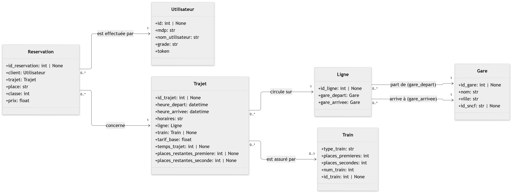

---
format:
  pdf:
    fontsize: "12pt"
    include-in-header: 
      text: |
        \usepackage{graphicx}
    geometry:
      - top=30mm
      - left=25mm
      - right=25mm
      - bottom=30mm
execute:
  echo: false
  warning: false
editor: 
  markdown: 
    wrap: 72
lang: fr
---

\begin{titlepage}
\centering

% Logo
\includegraphics[width=7cm]{images/ensai-logo.png}\par

\vspace{1.5cm}

% Titre principal
{\Huge Rapport final - Projet informatique \par}
\vspace{0.5cm}
{\Large 2A \par}

\vspace{1.5cm}

% Sous-titre / Nom de l'application
{\LARGE \textbf{Concurrent SNCF} \par}

\vspace{1cm}

% Bloc Étudiants (aligné à gauche)
\begin{flushleft}
\large
\textbf{Étudiants :}\\
Adam BENAMER\\
Satya KREMER\\
Nathan TIATIA\\
Laurine LEROY\\
Lou-Ann CLEMENT\\
Nour NSIRI
\end{flushleft}

\vspace{0.05cm}

% Bloc Encadrant 
\begin{flushright}
\large
\textbf{Encadrant pédagogique :}\\
KEVIN LEROY
\end{flushright}

\vfill

% Année universitaire
{\normalsize Année universitaire 2026--2027 \par}

\end{titlepage}
\tableofcontents
\newpage

# Introduction

Dans un monde exigeant une grande mobilité des personnes et des biens, se déplacer est devenu un enjeu majeur pour tous et toutes. Cependant, ces déplacements viennent souvent à l’encontre de préoccupations environnementales grandissantes. En effet, les trajets en avion ou même en voiture sont extrêmement polluants : il est donc pertinent de se pencher sur une de leurs alternatives la plus verte, c’est-à-dire le train. En effet, le train est une industrie inestimable pour faire face aux enjeux climatiques de notre monde. Ainsi, il est tout aussi nécessaire d’avoir des services qui font fonctionner la concurrence, afin de permettre aux utilisateurs des chemins de fer d’avoir la meilleure expérience possible. C’est pour cette raison que la création d’un concurrent à la SNCF s’impose comme un sujet particulièrement important, et demandant un traitement attentif et complet.

Afin d’accomplir cela, nous avons développé une application qui vise à mettre en place le plus grand nombre possible de fonctionnalités proposées par la SNCF : ce rapport vise donc à expliquer dans le détail comment cette application a été conçue, structurée et codée par notre équipe. Nous verrons dans un premier temps le contexte de l’application et le cahier des charges dressé, ainsi que l'organisation de travail mise en place au sein de l'équipe. Puis nous nous pencherons sur la modélisation de notre application et son architecture générale. Nous nous intéresserons ensuite à l'implémentation, notamment par le biais de diagramme de classes, afin d’expliciter les différentes couches de code mises en place et leurs interactions. Nous verronns aussi à cette occasion les outils utilisés et les tests mis en place dans une démarche d'assurance-qualité. Enfin, lors d'une dernière partie de prise de recul nous verrons les possibles modifications à notre application selon différents scénarios.

\pagebreak

# I. Présentation du projet

## Cahier des charges et fonctionnalités de l'application

Au cours de ce semestre, nous avons donc développé une application qui cherche à approcher au mieux les fonctionnalités proposées par la SNCF. Celles-ci sont constituées de cinq fonctionnalités de base et deux fonctionnalités optionnelles. Ces fonctionnalités utilisent parmi les données transmises par l’API SNCF les gares, lignes, trajets et prix présents dans la base de données. La récupération, l’exploitation et la transmission à notre base de données de ces données SNCF seront explicités lors de l’explication des couches de code.

La première fonctionnalité est une fonctionnalité de gestion des comptes utilisateurs, afin d’avoir les différents niveaux d’habilitation nécessaires à l’application. Ceux-ci sont au nombre de trois : les administrateurs sont les seuls à pouvoir changer le niveau d’habilitation d’autres comptes, mais ont accès à toutes les autres fonctionnalités accessibles aux deux autres catégories de compte, les collaborateurs et les clients. Tandis que les collaborateurs peuvent créer des lignes et trajets, les clients ne peuvent que rechercher ces lignes et trajets, et réserver les trajets disponibles.

La deuxième fonctionnalité demandée est celle de gestion des lignes d’exploitation. Cela est effectué par les comptes collaborateurs, en utilisant l’API externe de la SNCF. Pour faire cela, les collaborateurs recherchent d’abord des gares existantes dans la base de données de la SNCF. Cette recherche permet ensuite au collaborateur d’utiliser les gares obtenues pour vérifier l’existence d’une ligne dans la base de données de la SNCF, et de créer ladite ligne.

La troisième fonctionnalité que nous devons implémenter est celle de gestion des trajets proposés. Un trajet se trouve sur une ligne, et possède donc une date et une heure de départ, un nombre de places et un tarif. Le temps de trajet est calculé avec l’API SNCF, tandis que le nombre de places est une variable à ajuster par le collaborateur créant le trajet. En plus de cela, il est important de vérifier qu’un trajet peut bel et bien être effectué entre deux gares, et qu’il existe donc une ligne déjà créée par le compte collaborateur qui permet ce trajet. Enfin, les comptes collaborateurs sont capables de modifier ou bien de supprimer un trajet.

La quatrième fonctionnalité est celle de recherche de trajet : un compte client peut rechercher les trajets créés grâce à la fonctionnalité précédente, en entrant une gare d’arrivée et une gare de départ. A l’issue de cette recherche, toutes les informations nécessaires lors de la création d’un trajet sont visibles par le client, à l’exception du tarif et des places (qui peuvent être néanmoins visibles lors de la réservation d’un trajet).

La cinquième et dernière fonctionnalité est une fonctionnalité de positionnement commercial, laissée libre. Nous avons choisi d’implémenter la tarification transparente : ainsi, lors de la réservation d’un trajet, un client peut voir les différentes composantes du prix total. Nous avons aussi implémenté lors de la réservation la visibilité du nombre de places restantes dans la classe voulue (première ou deuxième).

De plus, nous avons aussi développé les deux fonctionnalités optionnelles proposées par le sujet : celle des classes de voyage, et la fonctionnalité de réservation. Cette dernière permet à un compte client de réserver et annuler une réservation, ainsi que de visualiser ses réservations.

## Organisation de l'équipe

L’organisation du groupe a été prise en charge par Lou-Ann Clement en tant que cheffe de projet, tandis que les questions purement techniques portant sur le code étaient gérées par Satya Kremer, le tech leader du groupe.

Les tâches étaient réparties lors de réunions de travail : lors de la phase d'analyse les diagrammes et parties du rapport ont été attribuées lors de ces réunions, et lors de la partie code plusieurs réunions ont euu lieu pour répartir les tâches. Au début celle-ci se présentaient sous la forme de classes à coder à travers plusieurs couches, et au fur et à mesure de l'avancement du projet ces tâches étaient des erreurs ou corrections remarquées par des membres de l'équipe, et distribuées à tous selon les capacités techniques de chacun. Pour améliorer la communication et la collaboration du groupe en dehors de ces réunions, un groupe Whatsapp a été utilisé régulièrement, ainsi qu'un Google Drive pour centraliser diagrammes et retours du tuteur notamment.;

\pagebreak

# II. Modélisation

## 2.1  Architecture globale

Figure : Arborescence du code
.png){fig-align="center" width="80%"}

Notre application repose sur quatre couches qui interagissent entre elles : \

- la couche de présentation (presentation layer), c'est-à-dire l'interface utilisateur (la seule avec laquelle l’utilisateur interagit) : le front end ou le Swagger ; \
- le backend, qui contient la couche métier (business layer), les contrôleurs, la couche service et la couche DAO ; \
- la couche de persistance : la base de données ; \
- la couche Webservices : l'API SNCF, composant externe. 

## 2.2  Diagramme de classes
Voici plus en détail les classes des différentes couches de la backend :

{fig-align="center" width="80%"}
Figure : Diagramme de classes - Business Layer MODIF SUPP CLASSE CLIENT

.png){fig-align="center" width="80%"}
Figure : Diagramme de classes - Service Layer et DAO Layer

### La couche métier

En premier lieu, les objets métiers modélisent les trains, les gares, les lignes, les trajets proposés sur l’application, ainsi que les utilisateurs et leurs réservations. Ils traversent toutes les autres couches qui, elles, servent à gérer ces objets. La gestion du grade (client, collaborateur ou administrateur) se fait via l’attribut `grade` d’`Utilisateur` plutôt que par trois classes filles emboîtées. Cela facilite les changements de grade faits par les administrateurs ainsi que la gestion des accès différenciés aux fonctionnalités.

### Les controllers

Les controllers reçoivent les requêtes HTTP du front end, et les transmettent à la couche service. Ils gèrent aussi l’authentification et la vérification du grade des utilisateurs. Les schémas (dans le dossier `schema`) fixent le format des requêtes utilisateurs et des réponses qui lui sont renvoyées.

### La couche service

La couche service regroupe les méthodes qui permettent de gérer les objets métiers. Chaque objet a sa classe service correspondante, avec des méthodes permettant de créer, modifier, supprimer l’objet ainsi que des méthodes spécifiques à chaque objet. De plus, il y a des classes service pour chaque profil d’utilisateur : `UtilisateurService`, `CollaborateurService` et `AdministrateurService`, qui permettent de séparer et d’identifier les fonctionnalités supplémentaires selon le profil. Un autre point important de la couche service est l’utilisation de l’API : elle est la seule à faire appel à `SncfClient`, d’abord dans `GareService` pour importer les gares  puis dans `TrajetService` pour vérifier qu’un trajet ferroviaire est possible entre les deux gares et, le cas échéant, calculer la durée d’un trajet.

### La couche DAO

La couche DAO est celle qui interagit avec la base de données. Elle donne accès aux informations stockées dans celle-ci et y enregistre les informations créées à partir de l’application. Chaque objet a sa classe DAO correspondante, qui contient les mêmes types d'opérations (créer, modifier, supprimer, rechercher, trouver par identifiant). Leurs méthodes renvoient directement des objets métiers qu’elles reconstituent à partir des informations de la base de données.

### Les utilitaires (dossier `utils`)

La classe `DBConnexion` dans le fichier `utils/db_connexion.py` est le point d’accès à PostgreSQL pour la base de données . Elle utilise la bibliothèque psycopg2 et lit les informations de connexion à la base de donnée PostgreSQL rangées dans le `.env` (hôte, port, base, utilisateur, mot de passe, schéma). Elle utilise un `Singleton` (`utils/singleton.py`) pour garantir que l'application ne partage qu'une seule connexion à la base. De même, la classe SncfClient sert à configurer une unique connexion à l’API SNCF.
[autres choses dans utils à mentionner?, securite?]

## 2.3  Base de données

### Rôle de la base de données dans l'application

Notre application s'appuie sur deux sources de données : l'API de la SNCF et une base de données PostgreSQL. L’un des premiers choix de conception du projet a donc été de répartir la tâche entre l’API et la base de données sans que l’un n’empiète sur l’autre. D’une part, l'API SNCF permet à l’application de récolter les informations de base sur les gares (nom, ville, id) et la durée des itinéraires entre deux gares notamment avec les endpoints. En revanche, elle n’est pas adaptée à notre application. En effet, elle ne connaît en rien ce qui est propre à notre application : les comptes utilisateurs, les trains de notre application, les lignes ouvertes par les collaborateurs, les trajets ainsi que les réservations des clients. Puisque ces données n'existent que chez nous, il nous faut les conserver dans la base de données. Nous avons également choisi d'enregistrer les gares en base, même si elles sont disponibles via l'API. Lorsqu'un utilisateur recherche une gare inconnue, la couche service envoie cette requête à l'API SNCF, puis enregistre les gares trouvées au sein de notre base de données. Les recherches suivantes sont faites directement dans notre base.

La conception de la base de données nous a fait enregistrer les gares dans la base de données pour deux raisons. La première est en rapport direct avec l’autocomplétion et la complexité de cette dernière. Lorsque l'utilisateur recherche une gare, l’application est faite tel que les propositions doivent apparaître pour compléter la recherche. Le fait d'interroger l'API SNCF à chaque lettre consommerait beaucoup de requêtes et rendrait notre interface dépendante de la rapidité d'un service externe. Cela est d’ailleurs en rapport avec la deuxième raison de ce choix. Cette décision porte sur la résilience de notre application. En effet, une fois que l’on importe les gares depuis l’API, ces dernières sont stockées dans la base et l’application peut fonctionner (recherche de gares, consultation des trajets, réservations), même lorsque l’API n’est pas disponible. Néanmoins, ce choix comporte une limite. Une gare qui n'est pas dans la base doit obligatoirement être importée depuis l’API. Si celle-ci est indisponible, l’utilisateur ne peut pas ajouter une nouvelle gare.

### Conception des tables

{fig-align="center" width="80%"}

Le schéma de notre base de données comporte six tables qui correspondent aux six objets métier définis pour notre application :
gares : les gares importées depuis l'API SNCF, identifiées en interne par id_gare et rattachées à l'API par id_sncf.
utilisateurs : les comptes de l'application, avec leur grade (ADMIN, COLLABORATEUR ou CLIENT).
lignes : une liaison entre une gare de départ et une gare d'arrivée, rattachée au collaborateur qui l'a créée.
trains : l’objet permettant de faire des trajets, avec sa capacité en première et en seconde classe.
trajets : un départ programmé sur une ligne, avec un train, des horaires et un tarif de base.
réservations : réservation d'une place, dans une classe donnée, par un client sur un trajet.
Ces tables reprennent les objets métier présentés dans le diagramme de classes. Chaque table correspond à une classe et à une DAO, ce qui rend le passage de la base aux objets direct et facile à suivre.

Nous avons délégué une partie des règles nécessaires à notre application à PostgreSQL lui-même, au moyen de contraintes. Une règle vérifiée par la base s'applique quel que soit le chemin emprunté par la donnée et ne peut pas être contournée par un oubli dans le code.
Clés primaires (SERIAL) : chaque enregistrement reçoit un identifiant unique généré par la base, que la DAO récupère.
Clés étrangères : une ligne ne peut relier que des gares qui existent, un trajet ne peut utiliser qu'une ligne et un train existants, et une réservation doit porter sur un client et un trajet réels.
Contraintes d'unicité (UNIQUE) : Pour les réservations, une même place ne peut pas être réservée deux fois sur un même trajet. Dans le cas où deux clients tenteraient de réserver la même place, la base refuserait la requête la plus tardive. La couche service intercepte alors l'erreur et la transmet à l’utilisateur. Pour ce qui est des utilisateurs, deux comptes ne peuvent pas porter le même nom, ce qui garantit qu'une connexion désigne un seul et unique compte. Un numéro de train et une gare SNCF n'existent qu'une fois dans la base de données..
Valeurs obligatoires sur les champs qui sont indispensables pour un compte (nom, mot de passe, grade).

Les clés étrangères imposent un ordre de création. C’est-à-dire qu’une table ne peut faire référence qu'à une autre table qui existe déjà. Pour la conception nous avons donc décidé de créer d'abord les tables qui ne dépendent d'aucune autre (gares, utilisateurs, trains), puis lignes, qui dépend des gares et des utilisateurs, puis trajets, qui dépend des lignes et des trains, et enfin réservations, qui dépend des trajets et des utilisateurs. Cet ordre suit directement les flèches du diagramme de la base de données.

### Initialisation et réinitialisation de la base

La structure de la base est décrite dans deux code, situés dans le dossier data/ :
init_bdd.sql crée les six tables avec leurs contraintes.
admin.sql crée trois comptes pour démontrer les fonctionnalités  par grade (administrateur, collaborateur, client). Leurs mots de passe sont stockés sous forme hachée, comme pour un compte créé depuis l'application.
Comme toute la structure est décrite dans ces fichiers, n'importe quel membre de l'équipe peut recréer une base identique à partir de zéro.
La classe Reset_bdd permet d’automatiser cette réinitialisation. C’est-à-dire qu’elle supprime le schéma de travail, le recrée, puis exécute les deux codes cités précédemment. Cette opération est réservée aux grade d’administrateur, via l'API. La réinitialisation nous aura été utile tout au long du développement du code de l’application. Elle nous permet de partir d'effectuer plusieurs tests manuels, de corriger rapidement une base devenue incohérente et de préparer un environnement propre avant une démonstration.

### Sécurité des données

Le code permet de protéger les identifiants de connexion d’un utilisateur. En effet, les informations qui permettent de se connecter à la base de données sont stockées dans un fichier .env, chargé au démarrage du PostgreSQL. Ce fichier est listé dans le .gitignore du projet Python et n'est donc jamais publié sur le Git. De plus, aucun mot de passe de la base de données n'apparaît dans le code source. Les mots de passe ne sont jamais stockés en clair. Ils sont hachés. Ainsi, deux utilisateurs ayant le même mot de passe obtiennent ainsi des mots de passes hachées différents. À la connexion, le mot de passe saisi est haché de la même façon, puis comparé à sa version hachée.

Le code est aussi protégé contre les injections SQL. Toutes les requêtes des DAO sont paramétrées. Cela signifie que les valeurs saisies par l'utilisateur ne sont jamais ajoutées au texte de la requête. Elles sont transmises séparément, par des paramètres comme %(nom)s, et c'est psycopg2 qui se charge de les insérer en échappant les caractères dangereux d’une possible requête SQL non-voulue. Même si un utilisateur saisit du code SQL dans le champ de recherche d'une gare, ce code est traité comme un simple texte et n'est jamais exécuté. 

# III. Implémentation

## 3.1  Vue globale des fonctionnalités et de leur utilisation

L’application propose des fonctionnalités différentes selon le grade de l’utilisateur. Comme dit précédemment, il s’agit de rôles en pyramide : un grade supérieur permet de faire les fonctionnalités de base, et d’autres fonctionnalités supplémentaires. 
Client < Collaborateur < Administrateur

Figure : diagrammes d’activité ?  cas d’utilisation ? ou à mettre en annexes 

Tous les utilisateurs peuvent : 

- Se connecter ;
- Rechercher des gares (avec autocomplétion) ;
- Rechercher les trajets entre deux gares pour un jour donné ;
- Consulter les caractéristiques d'un train ;
- Changer leur mot de passe.

Les collaborateurs ont, en plus, la possibilité de : 

- Importer des gares depuis l'API SNCF ; 
- Créer, modifier et supprimer des lignes ; 
- Créer, modifier et supprimer des trajets ; 
- Créer des trains et modifier leur capacité.

Enfin, les administrateurs peuvent en plus : 

- Rechercher un compte (par identifiant ou par nom d’utilisateur) ; 
- Modifier le grade d'un compte (sauf celui d'un autre administrateur).

Les utilisateurs ont accès à ces fonctionnalités depuis le front end ou le Swagger, après s’être connectés.

Toutes les fonctionnalités reposent avant tout sur l’authentification des utilisateurs. L’identité d’un utilisateur est toujours déduite par le token de connexion. Ainsi, un client ne peut pas, par exemple, supprimer la réservation d’un autre client.

[peut être ici pour parler de utils/securite -> hashage]

Pour toutes les fonctionnalités, les erreurs sont traduites en code HTTP retourné à l’utilisateur, signalant la cause de l’erreur : 401 (non connecté), 403 (grade insuffisant), 400 (donnée invalide ou règle métier non respectée), 404 (ressource introuvable) et 502 (API SNCF indisponible). 

La liste des endpoints pour chaque fonctionnalité est présentée en annexe. [annexe]

## 3.2  Exemples de cas d’utilisation

### Création d'un trajet par un collaborateur 
### Réservation d'une place par un client 
autres

## 3.3  Tests

## 3.4  Outils utilisés

